# T16 shortcut behavior — approved by Sascha on 2026-11-09

Sascha approved this flow through the Front agent on 2026-11-09 and explicitly waived a clickable fake for this task because the visible controls and dirty dialog already exist. The implementation interface remains subject to architecture review.

```mermaid
stateDiagram-v2
    [*] --> Ready
    Ready --> OtherWindow: Cmd+W, auxiliary focused
    OtherWindow --> Ready: existing close action
    Ready --> Pending: Cmd+W, main focused; issue bounded request
    Pending --> Pending: repeated shortcut or existing dirty guard
    Pending --> Handled: valid handled response
    Pending --> Unhandled: valid unhandled and same focused window/document
    Pending --> Unavailable: invalid response, timeout, navigation, focus change, destroyed window
    Handled --> Ready: existing tab close or dirty prompt owns action
    Unhandled --> Ready: existing main window close action
    Unavailable --> Ready: do not close window
```

A queued invocation must check its deadline and document generation before performing any renderer action. A stale result cannot invoke the window fallback. No path or document content crosses the process boundary.
