# Proposed T16 shortcut behavior — awaiting outside-in sign-off

This is a reviewable logic and interface proposal for the Front agent. The visible controls and dirty dialog already exist. This document is not a design export, a clickable fake or evidence of Sascha's sign-off.

```mermaid
stateDiagram-v2
    [*] --> Ready
    Ready --> OtherWindow: Cmd+W, auxiliary focused
    OtherWindow --> Ready: existing close action
    Ready --> Pending: Cmd+W, main focused; issue bounded request
    Pending --> Pending: repeated shortcut or existing dirty guard
    Pending --> Handled: valid handled response
    Pending --> Unhandled: valid unhandled and same focused window/document
    Pending --> Unavailable: invalid response, timeout, navigation, focus change, destroyed window
    Handled --> Ready: existing tab close or dirty prompt owns action
    Unhandled --> Ready: existing main window close action
    Unavailable --> Ready: do not close window
```

A queued invocation must check its deadline and document generation before performing any renderer action. A stale result cannot invoke the window fallback. No path or document content crosses the process boundary.
