# T16 shortcut behavior — approved by Sascha on 2026-11-09

Sascha approved this visible flow and waived a clickable fake for this task. Its technical realization is blocked by the unresolved focus-lifetime guarantee in `docs/reviews/T16-revised-spec.md`; this diagram is not a claim that the synchronization exists.

```mermaid
stateDiagram-v2
    [*] --> Ready
    Ready --> OtherWindow: Cmd+W, auxiliary focused
    OtherWindow --> Ready: existing close action
    Ready --> Ready: Cmd+W, no focused window
    Ready --> Pending: Cmd+W, main focused
    Pending --> Pending: repeat consumed
    Pending --> Unavailable: focus lifetime lost, navigation, destruction, replacement, expiry or failure
    Pending --> Handled: valid request, active tab or guard pending
    Pending --> Unhandled: valid request, no active tab
    Handled --> Ready: existing tab close or dirty guard owns action
    Unhandled --> Ready: valid result; existing main window close action
    Unavailable --> Ready: no tab action, prompt or window fallback
```

The validity check must be effective at the renderer side-effect instant, including native blur and refocus observed late; post-action rejection cannot undo a close or prompt. A valid unhandled result also requires a current window, document, focus lifetime and deadline at fallback. No path or document content crosses the process seam. The exact mechanism and authoritative ordering evidence remain unresolved; no implementation may assume the proposed R3 arm/act ordering.
