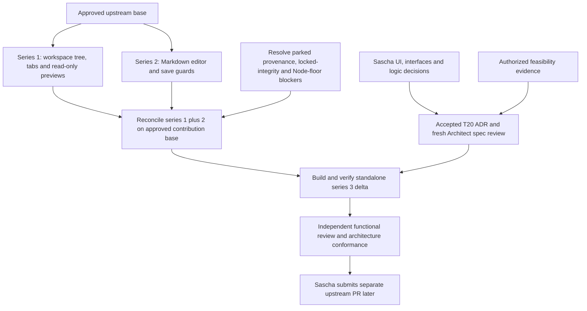

# T20 — questions for Front and later upstream plan

Status: proposal, updated 2026-11-10 with Sascha's Q1–Q10 product decisions, including Q5=B exceptions. Companion to [logic](logic.md), [proposed ADR-0009](../../docs/adr/0009-detached-document-window.md) and the [hardening outline](hardening-outline.md). No architecture choice, overall UI sign-off, implementation approval, series cut or upstream submission is claimed.

## Recorded requirement, not a feasibility claim

Sascha decided 2026-11-10, relayed by Front and the follow-up dispatch: the document window closes with chat and on leaving the room, never works independently, and both paths use existing Save/Discard/Cancel; Cancel keeps both windows open and unsaved Markdown is protected on normal chat-close/room-exit paths; the later Q5=B decision below explicitly scopes the exceptions. Room following/pinning after exit and independent child lifetime are removed from the option set. Explicit Discard is a user choice, never implied by save failure, timeout or native teardown.

The [logic close protocol](logic.md#proposed-correlated-close-decision) proposes a correlated request and explicit allow/refuse reply carrying owner/room/host/draft generations. Chat learns Cancel from a matching refusal and clears that continuation; timeout/unknown/late allow fails closed, pending save/conflict blocks exit, and one coordinator serializes simultaneous requests. It closes the child only on a current commit, requires matching child-closed evidence, and only then closes/hides chat or exits the room. Normal native close/refusal ordering still needs proof. Q5=B explicitly excepts forced process loss, OS kill and browser close/reload bypassing the async guard; volatile drafts can be lost on those paths. That exception does not authorize independent child operation or a new recovery store.

## Recorded Q1–Q3 decisions

Decided by: Sascha (2026-11-10), relayed in the latest coordinator dispatch:

| Question | Decision | Supersession |
| --- | --- | --- |
| Q1=A | A room-labelled strip with Show documents/Return stays in chat. | Replaces the earlier undecided strip/tab-strip alternatives. |
| Q2=A | One document window per chat session/room. | Replaces the earlier undecided window cardinality. |
| Q3=B | Remember the last position in Electron with visible-bounds validation/fallback; browser placement is best effort. | Supersedes earlier Q3=A (near-chat/manual placement). |

These Q1–Q3 decisions do not accept ADR-0009 or approve implementation; Q5=B and the remaining recommendation decisions are recorded below. The Front prototype, worktree `~/orca/workspaces/exxperts/t20-lane` and branch `bussard76/t20-design-lane` are outside this follow-up and are preserved untouched.

## Recorded Q4–Q10 decisions and remaining proof

Decided by: Sascha (2026-11-10), latest Front/Controller dispatch. Q5=B is selected: Save/Discard/Cancel protects normal chat close and leaving room; forced process loss, OS kill, and browser close/reload that bypasses async guard are explicit documented exceptions; child never independent. Cancel keeps both windows open on protected paths. This supersedes the earlier absolute requirement for those exception paths; C/D are not chosen and no durable recovery architecture is approved.

Sascha accepted exactly the following existing recommendations, reproduced verbatim from this file before this update. Acceptance is a product decision, not evidence that the behavior works:

| Question | Accepted recommendation, 2026-11-10 | Evidence limitation |
| --- | --- | --- |
| Q4 | Guard and close the current child, with explicit Detach to reopen in the new context; avoids stale draft/context routing. Leaving the room itself is already decided to close it. | Conversation identity and child-close ordering still need proof. |
| Q6 | Preserve the exact unsaved draft/conflict through in-memory transfer, contingent on proof; movement does not save. | Exact draft/conflict transfer is still contingent on proof. |
| Q7 | Return the document session, retaining tabs and any recoverable draft; explicit tab × uses its existing guard. | Actual child native × and tab × need separate tests. |
| Q8 | Tree, tabs, previews, Markdown Edit/Preview/RAW, save/conflict/dirty guards and active document. Keep preview snapshot semantics. | Core document behavior and snapshot semantics need browser evidence. |
| Q9 | Preserve workspace-relative path insertion where the existing browser drag path works; provide click/selection without implying clipboard side effects. | Cross-window drag intent only; still untested. |
| Q10 | Establish platform/entry-point evidence before promising desktop or browser support; preserve read-only/paired permissions. Native chat × must guard and close the child even if chat then hides to tray. | Mac/native entry-point proof is still required; no platform support is inferred. |

Q1=A, Q2=A and Q3=B remain unchanged. These decisions do not select the portal/renderer transport or accept ADR-0009. The [hardening outline](hardening-outline.md) records source observations at Front commit `5533f71d4813f0b683ff49003e35ebe259b8bdab`, missing implementation/evidence and the work needed before presenting the ADR for acceptance. No fake, source comment, synthetic event or design decision is a substitute for real normal-close, cross-window drag or Mac proof.

## Proposed dependency map

Sascha's separate-series order is recorded in [issue #20's comment](https://github.com/bussard76/exxperts/issues/20#issuecomment-6763689112). The concrete reconciliation below is proposed, not an instruction to resume parked cuts.

Evidence read without creating checkouts or changing either series:

| Candidate reference read | Current tip | Relevant contents and limits |
| --- | --- | --- |
| `origin/agents/upstream-series-1` | `2e1b3937b65edb7d1c0da5c8a7d5e87efe5f37c2` | Tree/tabs/previews, `openWorkspaceFile`, read-only Markdown as text, guarded routes and preview checks. Excalidraw is excluded from the upstream plan. |
| `origin/agents/upstream-series-2` | `cdc3d5c29b7cfd959051b5594f50cef94e3211de` | Editor/Markdown routes, TipTap, save/conflict/navigation guards, notices and runtime type placement. Current source still has the older RAW view; the planned #17/#18 addendum is not proof those changes are already in this tip. |
| Merge base of those two tips | `461e6485bf932f5cba85ac3dde8e0104e47d5dec` | They are independent candidates, not a ready stacked series 1→2. Reconciliation must handle overlapping `App.tsx`, tree/tabs, styles, API/route and packaging hunks. |

Also read the Controller's `specs/series-1-architecture-draft.md`, `specs/series-2-architecture-draft.md` and `specs/series-2-raw-tasks-addendum.md`. They are planning evidence, not final approvals. Series 3 needs a base containing both functionalities: reconcile read-only `.md` from series 1 with series 2's editor and retain the correct preview branches. Keep intended #17/#18 additions and their tests when the series resume; check the final shared base instead of copying today's fork `App.tsx` wholesale. Reusing an unresolved dependency tree would not prove series 3 independently buildable.

#16's tab-close shortcut is not in this dependency map and supplies no proven focus/native mechanism. T20 must still guard any existing window-close entry point in its agreed scope; leaving #16 parked does not exempt native Cmd+W that closes the window. No work on provenance, Node floor, lock repair, #19, Excalidraw or the parked series themselves is part of T20 design.

## Proposed standalone series 3 commit plan

This is an ordered future product commit list, not existing commits or a branch to create now. Each slice includes its failing public-entry tests before its implementation; keep intermediate commits buildable and gate Detach availability until required lifecycle safeguards work. Use existing dependencies and keep the contribution delta restricted to relevant product hunks, product docs and invented-data tests.

| Order / proposed subject | Scope | Acceptance evidence before releasing the slice |
| --- | --- | --- |
| 1. `Keep workspace document state under one owner` | Minimal document-session ownership/rendering separation within the UI; retain attached behavior and existing exports unless specifically approved. | Existing tree/tab/editor/RAW, dirty navigation, save/conflict and preview suites still pass; exact draft and room identity preserved. No Detach affordance yet. |
| 2. `Render room documents in a separate window` | Approved child bootstrap, tree/tabs/previews/editor host, host-document event binding, styles/theme, portal frame-message handling and single-writer transfer seam. | Real producer/consumer browser flow for attach/detach/Return, exact dirty source/RAW/conflict, one editor and existing permissions; popup/CSP failure leaves attached host usable. |
| 3. `Guard detached document lifecycle and route chat references` | Current-host selection, correlated prepare/allow/refuse/commit/child-closed, owner/room/host/draft generations, serialized simultaneous actions, dependent shutdown and approved native handling. | Both decided close paths: Cancel keeps both windows open; timeout/unknown/late reply/duplicate commit, in-flight/lost-response save, conflict, room-generation reuse, child/native chat ×/tray/quit and partial teardown. No room retarget or independent child; prove normal-path protection and document the decided Q5=B exceptions before release. |
| 4. `Recover inaccessible document windows` | Always-available Return/Show and Q3=B Electron remembered position with visible-bounds validation/fallback; browser placement best effort. User-facing docs describing actual limits. | Offscreen/unplug recovery from chat, popup focus refusal and desktop bounds restore/fallback evidence are required by the chosen behavior. Exact storage/interface design remains for specification and architecture review; no new store is approved here. |

Likely product hunks: `apps/web-ui/src/App.tsx`, document tree/tab/editor/preview implementations, actual host-specific overlays and styles, existing entry bootstrap, plus `apps/desktop/src/main.ts`/window state only if the selected shell behavior requires them. Prefer existing internal seams and ReactDOM; exact new internal interfaces need approval. Expected dependency delta: zero, hence no T20 manifest/lock churn. If a new route, dependency, durable store, package export or protocol becomes necessary, return to Front/Architect rather than expanding this list silently.

Future checks on the reconciled series 1+2 base plus series 3: UI/scripts typechecks; affected script suites; real browser producer/consumer cases using invented files, fake server failures and fake OS opener; existing revision/permissions and preview isolation checks; desktop lifecycle/placement checks as selected. Developer uses targeted attributed gates; independent Tester/wave owns full build/smokes/browser verification and confirms the series builds without fork-only helpers. Sascha separately accepts packed native behavior. No real files, external services or paid model APIs.

The upstream diff must exclude `AGENTS.md`, factory config/hooks/tools/skills, Controller material, reports/reviews/specs/ADRs, these fork design artifacts, graph output, `CLAUDE.md` and binaries/screenshots. Keep existing source attribution/notices when moving product code. Validate the future changed-path list and dependency diff; do not declare the cut clean from its branch name. `agents/upstream-series-3` is a future label only: it was neither created nor pushed here.

## Draft separate PR description

The text below is a template, not a submitted PR or verified result. Fill the validation line from actual future runs, and rewrite lifecycle/placement details if Sascha chooses another option.

> **Title:** Move room documents into a separate window
>
> Detach a room's workspace tree, file tabs, previews and Markdown editor so documents can sit on a second monitor while chat remains visible. File references opened from chat target the current document host, with a single editor/save pipeline and the existing revision conflicts and unsaved-change choices.
>
> Depends on the document-pane changes in series 1 and the Markdown editor in series 2. Merge after both; this separate series 3 contains only the detach feature and its tests/docs, adds no dependency, and includes no fork factory files. Replace series names with the actual predecessor PR links before submission.
>
> Required lifecycle: the document window closes with chat and on leaving its room, with Save/Discard/Cancel on both paths; Cancel keeps both windows open. A correlated refusal or unknown result prevents parent exit and child closure. Return restores documents into chat; popup failure leaves them attached. Normal-path guard behavior still needs proof. Q5=B explicitly excepts forced process loss, OS kill and browser close/reload bypassing the async guard; it never permits independent child operation. Sascha decided on 2026-11-10: room-labelled Show documents/Return strip, one document window per chat session/room, and remembered Electron position with visible-bounds validation/fallback (browser best effort).
>
> Validation: pending implementation and testing on the reconciled series 1+2 base. Record typechecks, affected suites, browser/native lifecycle cases and standalone full-build results here before submission; no passing checks are claimed by this draft.

## Design-only self-review and handover evidence

| Binding item | Review result |
| --- | --- |
| Logic first, proposed ADR second, Front options third | Artifacts created in that order; logic contains both Mermaid diagrams and the complete issue-item checklist. |
| Decision authority | ADR remains proposed with `Decided by: Sascha pending`. Sascha's dated dependent-close/Save-Discard-Cancel/no-loss requirements and Q1=A/Q2=A/Q3=B product decisions are recorded separately; technical mechanism remains proposed; Q5=B scopes normal protection and documented exceptions, with C/D not chosen. No overall outside-in waiver or level-3 implementation approval is inferred. |
| Ownership, writes, saves, disconnects, switches, native dirty-close, popup, offscreen/recovery | Mapped item by item to future public-entry scenario names in logic; no feature tests are added or claimed as run. Key feasibility gaps are explicit. |
| Existing evidence and future series | Current code, T16 example, accepted relevant ADRs, template, both latest inbox entries and both parked candidate tips read; independent common-base branches distinguished from a future combined base. |
| Allowed files | This follow-up covers the T20 design documents/proposed ADR/hardening outline and the paired coordinator/workflow history update. No product code, lockfile, accepted ADR or hook edits; existing worktree lockfile change remains excluded. |
| Checks | All four Mermaid diagrams parse with installed Mermaid/JSDOM; local links/fences, ADR pending authority/template, close-contract field coverage and whitespace checks pass. Normal commit hooks run UI/scripts typechecks; no feature tests/full gate or browser captures, and no dependency install needed. |
| Graph | Yes: code-only `graphify update`, explain/path/query. 10 top-level tool calls through the first artifact edit (25 nested operations, including orchestration guide/heartbeat and graph waits). Graph confirmed known call structure; its broad query was noisy and gave no additional design evidence over source search. Generated output stays untracked/ignored. |
| Remaining work | Q5=B is decided; C/D are not chosen. Complete the acceptance-preparation and hardening proof obligations in the outline; normal close/refusal and draft preservation remain unproved, Q9 cross-window drag is untested, and Q10 Mac proof is still required. Design delivery is not feature completion or sign-off. |

Debt candidates: no new implementation debt is introduced. Native close ordering, recovery acknowledgement, child bootstrap, background-owner behavior, host-document event binding and preview message delivery are unresolved feasibility/acceptance work, not waived failures. The parked series' sources/locked-integrity/Node-floor blockers remain outside this task. Screenshots: none; later captures must remain untracked under `.build/screenshots/`.

Setup/check history: the first signed commit attempt was rejected by the normal hook because runtime `dist` declarations were absent; `design/` and ADR paths do not use the hook's documentation exemption. Building the existing `@exxeta/exxperts-ai`, `@exxeta/exxperts-core`, `@exxeta/exxperts-tui` and `@exxeta/exxperts-runtime` workspaces generated only ignored outputs and cleared the type errors on retry. No source, test or hook fix was needed. The initial bare-Node Mermaid parse lacked DOMPurify's DOM environment; repeating with installed JSDOM parsed all three diagrams successfully. These are setup/harness observations, not product findings or feature-test passes.

Final reconciliation: fetched and merged `origin/main` at `3fe7bc75ad43199f9becde9ef85d99e876051b55` (already up to date), then UI typecheck and `typecheck:scripts` passed again. The branch diff contains exactly the three allowed proposal artifacts, each commit is DCO signed, and the pre-existing unstaged lockfile delta remains excluded. Self-review clarified that preserving an unresolved conflict is allowed during non-destructive Return; failure to capture the session safely blocks movement, rather than conflict status alone. No behavior was implemented, so TDD/feature suites/browser/full gate were not invoked.

Earlier follow-up self-review, 2026-11-10: updated logic first, then proposed ADR and these Front options. Both decided close triggers now close the dependent child instead of retargeting it; explicit refusal explains how Cancel reaches chat. Request/owner/room/host/draft identity, pending saves/conflicts, timeout/unknown/late replies, duplicate requests/commits, simultaneous actions and teardown acknowledgement are specified as proposed proof obligations. Before commit, refused/unknown requests withhold both closes; after a commit with missing child-closed acknowledgement, chat stays put with retained session but the child may already be gone. No atomic native two-window close, forced-termination safety or immediate orphan shutdown is claimed. At that earlier review Q1–Q3 were defaults; the dated Q1=A/Q2=A/Q3=B decisions above now supersede that status, including earlier Q3=A. Q5 scope/recovery/deferral choices were open at that earlier review, superseded by the Q5=B decision above, and series 3 still depends on reconciled series 1+2. ADR acceptance, implementation, durable stores and upstream writes remain unauthorized.

Latest follow-up, 2026-11-10: Q5=B supersedes the earlier open fallback/absolute-guarantee wording; Q4 and Q6–Q10 accepted recommendations above are copied exactly from the prior version. Read-only inspection is pinned to `origin/bussard76/t20-design-lane` at `5533f71d4813f0b683ff49003e35ebe259b8bdab`; no Front worktree/branch edit, lane execution, product implementation or EXXETA write occurred. The new outline separates observed prototype code from missing behavior and proof, while ADR-0009 remains proposed with `Decided by: Sascha pending`.
