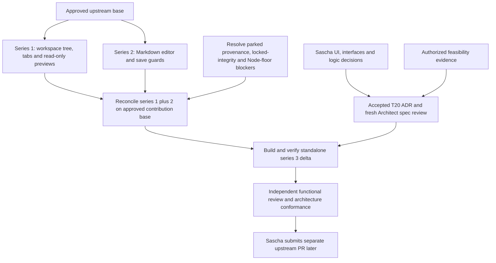

# T20 — questions for Front and later upstream plan

Status: proposal, 2026-11-10. Companion to [logic](logic.md) and [proposed ADR-0009](../../docs/adr/0009-detached-document-window.md), written in that order. No architecture choice, UI sign-off, implementation approval, series cut or upstream submission is claimed.

## Questions for Sascha

Front should ask one question at a time, recommended option first. Q1–Q3 are the issue's explicit open questions; Q4 onward make the lifecycle consequences visible before choosing the architecture. All recommendations below are agent assumptions, not recorded Sascha decisions.

| ID | Question | Recommended proposal | Practical alternatives and tradeoff |
| --- | --- | --- | --- |
| Q1 | What stays in chat while documents are detached? | A small room-labelled strip with Show documents and Return; no duplicate tabs/editor. | Keep a read-only tab strip for selection (more coordination/UI), or show nothing beyond a detach toggle (quieter, harder to recover an inaccessible window). |
| Q2 | How many document windows? | One per active chat session, containing that room's document tabs. Repeated Detach focuses it. | One persistent window per room (parallel room work, more ownership to track), or one per file (more placement/close/conflict cases). Existing independent chat sessions still use server revision conflicts. |
| Q3 | Where does the window open? | Near chat with manual placement and always-available Return. No remembered position in the first slice. | Remember last position in Electron with visible-bounds validation and fallback; browser placement remains best effort. Pointer screen placement needs platform/permission evidence and may surprise keyboard users. Does Sascha require automatic second-monitor placement for the first version? |
| Q4 | Does the document window follow chat to another room/conversation? | Follow only after the current editor's Save/Discard/Cancel guard; Cancel keeps both in the old room. | Pin to original room (supports parallel work, but chat links need explicit routing and room labels), or return/close on room change (simpler binding, more window churn). |
| Q5 | Must documents keep working after the chat window really closes? | A dependent child; tray hide keeps the owner alive, actual owner destruction ends the session. Confirm platform leave/stay warnings and the volatile-draft limitation first. | An independent child survives and owns edits (ADR option B, requires a handoff protocol), or forbid dirty owner close where the platform can guarantee it. Browser close/force quit cannot be promised an asynchronous custom guard. |
| Q6 | What happens to a dirty document during Detach or Return? | Preserve the exact unsaved draft/conflict through in-memory transfer, contingent on proof; movement does not save. | Require Save/Discard/Cancel before moving (smaller implementation, an extra interruption); Cancel stays put. Silent save/discard is not a proposed option. What loss on forced owner/process exit is acceptable? Durable draft recovery would be a separate architecture decision. |
| Q7 | Should native child × return documents to chat or close their tabs? | Return the document session, retaining tabs and any recoverable draft; explicit tab × uses its existing guard. | Close all tabs with a guard (more destructive), or keep session dormant for reopen. Native browser prompts differ from an app Close/Return button; agree that distinction. |
| Q8 | Which document interactions must survive movement? | Tree, tabs, previews, Markdown Edit/Preview/RAW, save/conflict/dirty guards and active document. Keep preview snapshot semantics. | Also preserve scroll, zoom, selection, search/undo history and expanded directories exactly (more host-transfer state). Decide which are acceptance requirements before the spec; moving should not silently refresh files or mutate untouched Markdown. |
| Q9 | What should dragging a child-tree file into chat do? | Preserve workspace-relative path insertion where the existing browser drag path works; provide click/selection without implying clipboard side effects. | Explicit Insert path action across windows (new intent, needs UI agreement), or defer cross-window drag with a visible documented limit. This cannot be assumed from same-document drag tests. |
| Q10 | Which clients can detach, and what changes for shortcuts? | Desktop and capable desktop browsers, with existing read-only/paired permissions; leave Cmd+W behavior unchanged while #16 is parked. | Limit first release to Electron (requires revising browser scope), or hide/disable Detach on constrained/mobile clients with an explanation. Agree keyboard focus, accessible names, theme/zoom, native close and browser popup limitations in the UI draft/fake. |

Recommended first architecture discussion: does the child need to survive actual owner destruction (Q5)? If yes, A's dependent-host lifetime does not meet the requirement and Front should present ADR option B. If no, authorize a bounded feasibility task for A before accepting detailed lifecycle promises. If its proof fails, retain B–D as open options; do not treat this recommendation as the decision.

## Proposed dependency map

Sascha's separate-series order is recorded in [issue #20's comment](https://github.com/bussard76/exxperts/issues/20#issuecomment-6763689112). The concrete reconciliation below is proposed, not an instruction to resume parked cuts.

Evidence read without creating checkouts or changing either series:

| Candidate reference read | Current tip | Relevant contents and limits |
| --- | --- | --- |
| `origin/agents/upstream-series-1` | `2e1b3937b65edb7d1c0da5c8a7d5e87efe5f37c2` | Tree/tabs/previews, `openWorkspaceFile`, read-only Markdown as text, guarded routes and preview checks. Excalidraw is excluded from the upstream plan. |
| `origin/agents/upstream-series-2` | `cdc3d5c29b7cfd959051b5594f50cef94e3211de` | Editor/Markdown routes, TipTap, save/conflict/navigation guards, notices and runtime type placement. Current source still has the older RAW view; the planned #17/#18 addendum is not proof those changes are already in this tip. |
| Merge base of those two tips | `461e6485bf932f5cba85ac3dde8e0104e47d5dec` | They are independent candidates, not a ready stacked series 1→2. Reconciliation must handle overlapping `App.tsx`, tree/tabs, styles, API/route and packaging hunks. |

Also read the Controller's `specs/series-1-architecture-draft.md`, `specs/series-2-architecture-draft.md` and `specs/series-2-raw-tasks-addendum.md`. They are planning evidence, not final approvals. Series 3 needs a base containing both functionalities: reconcile read-only `.md` from series 1 with series 2's editor and retain the correct preview branches. Keep intended #17/#18 additions and their tests when the series resume; check the final shared base instead of copying today's fork `App.tsx` wholesale. Reusing an unresolved dependency tree would not prove series 3 independently buildable.

#16 is not in this dependency map: existing window close behavior remains unless separately resumed and approved. No work on provenance, Node floor, lock repair, #19, Excalidraw or the parked series themselves is part of T20 design.

## Proposed standalone series 3 commit plan

This is an ordered future product commit list, not existing commits or a branch to create now. Each slice includes its failing public-entry tests before its implementation; keep intermediate commits buildable and gate Detach availability until required lifecycle safeguards work. Use existing dependencies and keep the contribution delta restricted to relevant product hunks, product docs and invented-data tests.

| Order / proposed subject | Scope | Acceptance evidence before releasing the slice |
| --- | --- | --- |
| 1. `Keep workspace document state under one owner` | Minimal document-session ownership/rendering separation within the UI; retain attached behavior and existing exports unless specifically approved. | Existing tree/tab/editor/RAW, dirty navigation, save/conflict and preview suites still pass; exact draft and room identity preserved. No Detach affordance yet. |
| 2. `Render room documents in a separate window` | Approved child bootstrap, tree/tabs/previews/editor host, host-document event binding, styles/theme, portal frame-message handling and single-writer transfer seam. | Real producer/consumer browser flow for attach/detach/Return, exact dirty source/RAW/conflict, one editor and existing permissions; popup/CSP failure leaves attached host usable. |
| 3. `Guard detached document lifecycle and route chat references` | Current-host selection, room/conversation guards, stale completion rejection, close/reopen and recovery; native browser/desktop handling under the approved policy. | All scenario names in logic checklist, both dirty-close directions, native Cancel/Leave, tray hide/quit, in-flight/lost-response saves, disconnect/foreground, child loss; no duplicate writer after timeout. UI affordance enabled only after these pass. |
| 4. `Recover inaccessible document windows` | Always-available Return/Show; desktop remembered bounds/display handling only if chosen. User-facing docs describing actual limits. | Offscreen/unplug recovery from chat; popup focus refusal; optional desktop placement tests. No new bounds store by accident. If manual placement is chosen, include the recovery UI with commit 3 and omit a separate placement commit. |

Likely product hunks: `apps/web-ui/src/App.tsx`, document tree/tab/editor/preview implementations, actual host-specific overlays and styles, existing entry bootstrap, plus `apps/desktop/src/main.ts`/window state only if the selected shell behavior requires them. Prefer existing internal seams and ReactDOM; exact new internal interfaces need approval. Expected dependency delta: zero, hence no T20 manifest/lock churn. If a new route, dependency, durable store, package export or protocol becomes necessary, return to Front/Architect rather than expanding this list silently.

Future checks on the reconciled series 1+2 base plus series 3: UI/scripts typechecks; affected script suites; real browser producer/consumer cases using invented files, fake server failures and fake OS opener; existing revision/permissions and preview isolation checks; desktop lifecycle/placement checks as selected. Developer uses targeted attributed gates; independent Tester/wave owns full build/smokes/browser verification and confirms the series builds without fork-only helpers. Sascha separately accepts packed native behavior. No real files, external services or paid model APIs.

The upstream diff must exclude `AGENTS.md`, factory config/hooks/tools/skills, Controller material, reports/reviews/specs/ADRs, these fork design artifacts, graph output, `CLAUDE.md` and binaries/screenshots. Keep existing source attribution/notices when moving product code. Validate the future changed-path list and dependency diff; do not declare the cut clean from its branch name. `agents/upstream-series-3` is a future label only: it was neither created nor pushed here.

## Draft separate PR description

The text below is a template, not a submitted PR or verified result. Fill the validation line from actual future runs, and rewrite lifecycle/placement details if Sascha chooses another option.

> **Title:** Move room documents into a separate window
>
> Detach a room's workspace tree, file tabs, previews and Markdown editor so documents can sit on a second monitor while chat remains visible. File references opened from chat target the current document host, with a single editor/save pipeline and the existing revision conflicts and unsaved-change choices.
>
> Depends on the document-pane changes in series 1 and the Markdown editor in series 2. Merge after both; this separate series 3 contains only the detach feature and its tests/docs, adds no dependency, and includes no fork factory files. Replace series names with the actual predecessor PR links before submission.
>
> Proposed lifecycle: Return restores documents into chat; room changes use the current dirty guard; failed popups leave documents attached; inaccessible windows can be recovered from chat. The document window depends on its chat owner, and unsaved work is volatile if that owner/process is destroyed. Native close, placement and recovery wording must match the final agreed policy.
>
> Validation: pending implementation and testing on the reconciled series 1+2 base. Record typechecks, affected suites, browser/native lifecycle cases and standalone full-build results here before submission; no passing checks are claimed by this draft.

## Design-only self-review and handover evidence

| Binding item | Review result |
| --- | --- |
| Logic first, proposed ADR second, Front options third | Artifacts created in that order; logic contains both Mermaid diagrams and the complete issue-item checklist. |
| Decision authority | ADR remains proposed with `Decided by: Sascha pending`; every UI/ownership recommendation above remains open. No outside-in waiver or level-3 approval is inferred. |
| Ownership, writes, saves, disconnects, switches, native dirty-close, popup, offscreen/recovery | Mapped item by item to future public-entry scenario names in logic; no feature tests are added or claimed as run. Key feasibility gaps are explicit. |
| Existing evidence and future series | Current code, T16 example, accepted relevant ADRs, template, both latest inbox entries and both parked candidate tips read; independent common-base branches distinguished from a future combined base. |
| Allowed files | Only `design/t20-detach-window/logic.md`, this file and proposed `docs/adr/0009-detached-document-window.md`; no task report, product code, lockfile, accepted ADR or hook edits. Existing worktree lockfile change remains excluded. |
| Checks | Three Mermaid diagrams parsed with the installed Mermaid plus JSDOM; local links/fences, proposed ADR template/authority and `git diff --check` pass. Normal commit hooks run UI/scripts typechecks; no feature tests/full gate or browser captures, and no dependency install needed. |
| Graph | Yes: code-only `graphify update`, explain/path/query. 10 top-level tool calls through the first artifact edit (25 nested operations, including orchestration guide/heartbeat and graph waits). Graph confirmed known call structure; its broad query was noisy and gave no additional design evidence over source search. Generated output stays untracked/ignored. |
| Remaining work | Front asks the open questions; Sascha decides; separately authorize feasibility/outside-in evidence and implementation review. Design delivery is not feature completion or sign-off. |

Debt candidates: no new implementation debt is introduced. Native close ordering, recovery acknowledgement, child bootstrap, background-owner behavior, host-document event binding and preview message delivery are unresolved feasibility/acceptance work, not waived failures. The parked series' sources/locked-integrity/Node-floor blockers remain outside this task. Screenshots: none; later captures must remain untracked under `.build/screenshots/`.

Setup/check history: the first signed commit attempt was rejected by the normal hook because runtime `dist` declarations were absent; `design/` and ADR paths do not use the hook's documentation exemption. Building the existing `@exxeta/exxperts-ai`, `@exxeta/exxperts-core`, `@exxeta/exxperts-tui` and `@exxeta/exxperts-runtime` workspaces generated only ignored outputs and cleared the type errors on retry. No source, test or hook fix was needed. The initial bare-Node Mermaid parse lacked DOMPurify's DOM environment; repeating with installed JSDOM parsed all three diagrams successfully. These are setup/harness observations, not product findings or feature-test passes.

Final reconciliation: fetched and merged `origin/main` at `3fe7bc75ad43199f9becde9ef85d99e876051b55` (already up to date), then UI typecheck and `typecheck:scripts` passed again. The branch diff contains exactly the three allowed proposal artifacts, each commit is DCO signed, and the pre-existing unstaged lockfile delta remains excluded. Self-review clarified that preserving an unresolved conflict is allowed during non-destructive Return; failure to capture the session safely blocks movement, rather than conflict status alone. No behavior was implemented, so TDD/feature suites/browser/full gate were not invoked.
