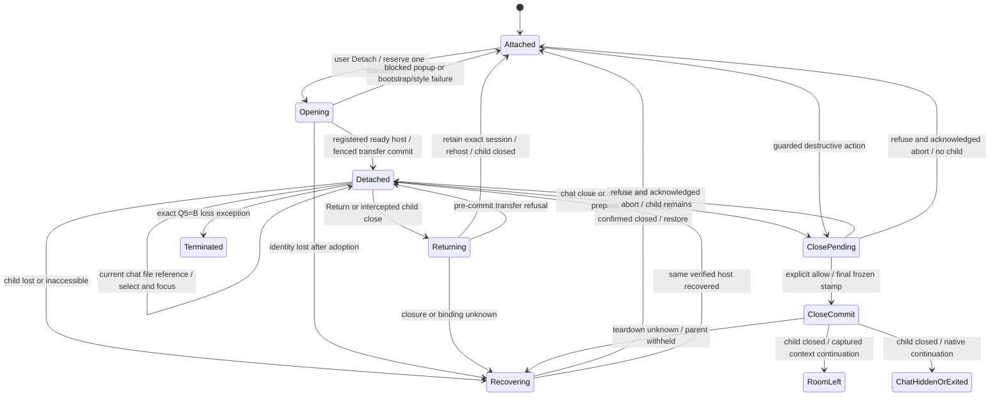

# T20 — accepted ownership and lifecycle logic

Status: revised author draft, 2026-11-11. Architecture A is accepted in [ADR-0009](../../docs/adr/0009-detached-document-window.md); the clickable UI basis `5533f71d4813f0b683ff49003e35ebe259b8bdab` was approved by Sascha on 2026-11-11. The [strip](recovery-strip.md) remains a draft. A fresh different Architect must review [T20-HARDEN](../../docs/specs/T20-HARDEN.md) before a subsequent build dispatch. Diagrams describe required behavior, with no runtime proof supplied.

## Architecture impact

Level 3: one chat-owned document session crosses attached/child host documents in apps/web-ui; apps/desktop adds native lifecycle and child-placement mediation. Existing server policy/revision/preview interfaces remain unchanged. ADR-0002/0003/0004/0008 remain binding. No second App/socket/editor/save pipeline, public package export, dependency, route or new durable store is authorized. The [contract register](contracts.md) is the single source for exact types, ownership, results, ordering, timeouts and provenance.

## Terms and responsibilities

Selectively carried forward from proposal `3e3d1a7c6de526558565cfb8684e4a98d707923a`, with historical approval status superseded:

| Term | Meaning |
| --- | --- |
| Chat window | The room conversation surface and lifetime owner of its document session. |
| Document session | Ordered open paths, active path, room/conversation identity, exact source/baseline/revision, dirty/conflict/save state and one guarded continuation retained in chat memory. |
| Document host | The single visible place containing the workspace tree, tabs, previews and editor: attached pane or detached child. |
| Writer | One live Markdown engine/save pipeline for this session; the server still rejects revision conflicts between independent chat sessions. |
| Return | Move the session into chat without closing tabs, saving, normalizing or discarding. Child × has this meaning; tab × remains a separate guarded destructive action. |

The approved prototype's stable portal-container approach is retained. App keeps a volatile recoverable session outside child DOM lifetime, and host consumers bind their actual ownerDocument/defaultView. Unrelated right-pane occupants and room navigation remain with chat. No file is needed to detach the workspace tree/empty state. A denied or missing workspace gains no access by moving.

## Window states



A slow/unfocused window is not gone. Timeouts retain authority and fail closed; they cannot create a replacement writer. Before commit, Cancel retains both windows and old context. After commit with unknown teardown, the child might already be gone: retain chat and recover the session, without claiming atomic closure. Forced process loss/OS kill/browser async-guard bypass are exactly Q5=B; no normal native exception is inferred.

## One guarded continuation

```mermaid
sequenceDiagram
    participant N as Requester or native shell
    participant O as Chat owner arbiter
    participant E as Retained editor engine
    participant H as Registered child host
    N->>N: Prevent native side effects synchronously if applicable
    N->>O: prepare immutable action and current correlation
    O->>E: Fence input and scheduling; settle latest write
    O->>O: Existing Save / Discard / Cancel in chat
    alt Cancel, conflict, error, unknown write or deadline
        O-->>N: matching refused or unknown
        N->>O: abort same request
        O-->>N: abort-ack; retained session
    else allow under final frozen stamp
        O-->>N: prepared allow with final correlation
        N->>O: commit same correlation
        O->>H: Fence view; close registered dependent child
        H-->>N: authoritative closed evidence
        N->>O: child-closed matching this child and action
        O-->>N: completed
        N->>N: Execute captured continuation once
    end
```

Calls inside the owner remain local calls; only the desktop boundary uses C5's bounded exchange. First admitted action wins; others are busy and cannot overwrite its callback/target. Abort/commit/closed are correlated and idempotent. Missing abort acknowledgement retains the arbiter; late allow cannot revive it. No-child completion is explicit. Room/conversation exit closes before state replacement; entering the next room never silently follows/reopens the old child.

## Source, writes and previews

Q6 requires exact recoverable in-memory source/conflict through movement. Transfer briefly fences the same retained engine, never calls save/discard or passes RAW text through rich normalization. Pending saves retain one latest-save drain; an unknown write is reconciled with the existing GET/revision seam before destructive continuation. Explicit Discard cannot undo a PUT already sent. Reload/Keep mine remain user choices in the document host.

A portal-container move can reload nested iframe contexts. C7 therefore retains original tab snapshots and bytes under owner lifetime and binds each fresh controlled frame instance to its actual host parent window. No arbitrary navigated frame is rearmed, no disk refresh occurs because of movement, and no old/foreign frame gains another file. Existing CSP/sandbox, one delivery per concrete preview instance and accepted self-navigation risk remain. Neither node movement nor synthetic parent messages prove this behavior.

Tree drag uses the existing workspace-relative MIME and composer insertion path, with current-context validation. Actual cross-window drag and Mac/native prevention need real entry-point evidence before support claims. [Front's MAC-TASK draft](front-options.md#mac-task-draft-for-front-via-controller) records the required final candidateSHA/OS/app/entrypoint evidence. No check is executed by these diagrams.
