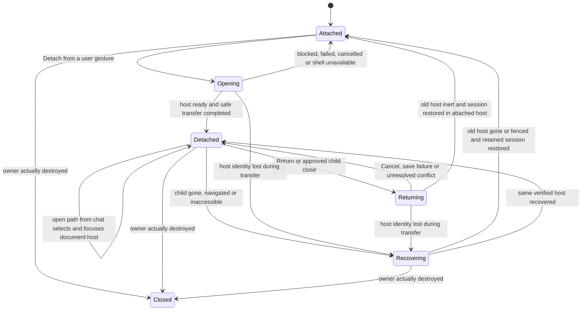
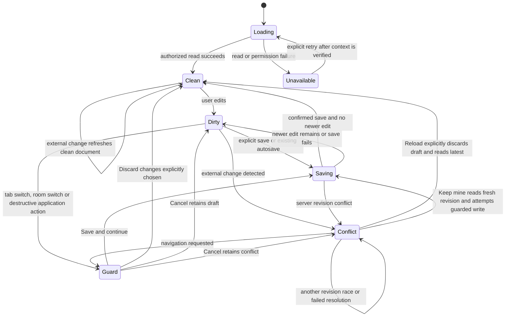

# T20 — detached document window: logic proposal

Status: proposed, 2026-11-10. No UI, interface or logic sign-off; no authorization to implement. The diagrams describe intended behavior for discussion, not working synchronization.

## Architecture impact

Level 3: document ownership and lifecycle cross the chat-window/document-window interface in `apps/web-ui`; optional window placement touches `apps/desktop`. No product change is made here. The proposal aims to reuse existing room HTTP interfaces, React/ReactDOM and workspace policy, with no new dependency, server route, public package export or durable store. A fresh Architect must review the eventual specification after Sascha's decision is recorded in an accepted ADR.

## Authority and assumptions

- Sascha's idea: [issue #20](https://github.com/bussard76/exxperts/issues/20), including its 2026-11-10 comment: a separate later upstream series 3 depending on document-pane series 1 and editor series 2.
- Both latest entries in `~/controller-exxperts/inbox-done.md`, read 2026-11-10, order logic first, proposed ADR second, then Front questions. They prohibit building and keep series cuts parked. They do not decide the options below.
- Example: `origin/agents/t16-r5-design:design/t16-close-shortcut/logic.md`. Its approved flow is not approval for T20. #16 is now deferred; neither its close accelerator nor its unresolved focus mechanism is a prerequisite.
- Accepted ADR-0002 preserves room/workspace permissions; ADR-0003 preserves local-only explicit OS opening; ADR-0004 preserves contained previews; ADR-0008 defines modules. None approves cross-window state ownership. There is no maintained `ARCHITECTURE.md` baseline.
- Assumption for this proposal: one document window for the currently selected room/conversation of one chat-window session. Switching rooms retargets that window only after the old document's guard completes. Multiple independent chat sessions are not globally locked by this proposal.
- Assumption: detach moves the workspace tree, workspace tabs, file previews and Markdown editor. Approval previews, task runs, attachments and room navigation remain with chat. Moving the entire shared right-pane slot would exceed the idea's document scope.

## Terms and ownership

These terms are provisional and local to this design; no project glossary is changed before agreement.

| Term | Meaning |
| --- | --- |
| Chat window | The room conversation surface and proposed lifetime owner of its document session. |
| Document session | The ordered open paths, active path, room/conversation identity, draft, baseline/revision, dirty/conflict/save status and pending guarded action for that chat session. |
| Document host | The single visible place containing the workspace tree, tabs, previews and editor: attached pane or detached window. |
| Writer | The one live Markdown editor/save pipeline for this document session; the server still arbitrates conflicting filesystem writes. |
| Return | Move the document host into the chat window without closing its tabs. Closing a tab is a separate existing action. |

Recommended exploration: keep one React owner in the chat window and render the document host into a same-origin child using ReactDOM's existing portal facility. The child is a presentation host, not a second `App`, room socket or independently writing editor. A same-origin app-served shell using the existing static entry is a candidate; a distinct server route is not presumed necessary. Bootstrap, headers and desktop popup behavior need proof before selecting the exact URL or shell.

| State | Session authority | Editor and save owner | Chat references |
| --- | --- | --- | --- |
| Attached | Chat React owner | One editor in attached host | Open via existing document selection. |
| Opening | Chat retains session and attached host | Attached editor until transfer is committed; no second editor | Serialize selection/transfer requests. |
| Detached | Chat React owner; child holds no independent canonical copy | One editor rendered in child; same room HTTP save interface | Forward to the session, select/focus child; no attached editor. |
| Returning | Chat retains session; editor controls paused | Settle in-flight work and capture latest draft before replacing host | Queue at most the current requested action. |
| Recovering | Chat retains last acknowledged in-memory session | No replacement writer until old host is confirmed gone or made inert | Show recovery action, never silently open another editor. |

The required small prefactoring is to separate workspace-document rendering from `App.tsx`'s mixed right-pane occupants and lift recoverable editor state into the document session. Currently `MarkdownEditorPane` holds its draft internally; `MarkdownEditorHandle` exposes only save/discard/focus. A portal alone does not preserve drafts, prove native-close safety, or fix listeners bound to the wrong document. Exact internal interfaces remain for the later spec; this is not a new global store or an approval to add one.

## Window states

`Closed` is termination, not proof of a save. Native close/quit is subject to the separate limitations below. A slow or backgrounded window is not a dead window; elapsed time alone never grants a second writer.

## Document lifecycle

Guard cancellation restores the exact previous phase; the two Cancel arrows are conditional alternatives. A successful guard runs only the still-current pending action, once, after save completion; save error/conflict cancels continuation. Switching room, conversation or person invalidates old asynchronous results and pending actions. No file or draft is relabeled under a new room identity.

## Saves, transfer and failures

1. **One writer:** one document host, one dirty-navigation prompt and one save pipeline per session. Both tree clicks and chat links use the same selection action. Existing independent app windows or external file editors may still race; the server revision check remains the safety net, not a session-wide lock.
2. **Save:** preserve explicit save, existing autosave, clean-file polling and read-only behavior. `PUT workspace-markdown` still sends content and expected revision under the original room/conversation/path. Never add an unconditional overwrite, new save endpoint or detach-triggered autosave rule. A lost HTTP response is not a confirmed failure to write: retain the draft and reconcile the current revision before retry/continuation. Reconnect alone does not authorize overwriting.
3. **Conflict:** Reload and Keep mine retain their existing meanings. Keep mine is explicit and still revision-checked. Failed save, lost permission, changed workspace or disconnected server retains the draft and blocks any destructive continuation. A chat WebSocket disconnect does not by itself prove HTTP saves are unavailable or that the child is dead.
4. **Host transfer:** freeze editor input and new selections, wait for existing saves to settle, and capture the latest source, baseline/revision and dirty/conflict state before removing the source host. Install one destination, restore the session, then enable input. Movement itself must not save, discard, normalize untouched Markdown or clear conflict. RAW, rich Edit and Preview must refer to the same draft. Restore focus in the destination; selection, scroll, zoom and search preservation need an explicit scope decision. If safe transfer cannot be proved, remain in the old host; offer Save/Discard/Cancel as an alternative product policy, not an implicit fallback.
5. **Detach failure:** open from the initiating click, keep the attached host until readiness is verified, and show an actionable failure if popup creation, shell initialization or transfer fails. Do not leave an empty pane, duplicate writer or endlessly open spinner. A returned handle alone is not readiness. A second click focuses the known child instead of opening another. Ignore stale completion from an earlier attempt.
6. **Room/conversation switch:** ask the owning editor's existing Save/Discard/Cancel guard, including when initiated from chat while the child is focused. Cancel/failure keeps both windows in the old room. On success, invalidate old requests, reset tabs as today and rebind the single document host to the new identity. The proposed child title always names its room. Whether it follows or stays pinned is still a Front question.
7. **App-controlled Return/close:** Return keeps tabs and draft; tab × closes a tab using the existing guard. A proposed document-window Close control returns the host. Native window × is a distinct event and cannot be assumed to await an asynchronous custom save. A current in-memory draft mirror in the chat owner is required for recovery after unexpected child loss; its exact edit acknowledgement ordering must be proved before promising lossless recovery.
8. **Native dirty-close, both directions:** register the available native unsaved-change protection on the actual editing document and on the owning chat document while a draft/save is at risk. Browser native unload can offer only the platform's generic leave/stay behavior; custom Save/Discard/Cancel belongs to app-controlled actions. No save-on-unload promise. Main Electron close currently hides to tray, so hiding must keep the document session alive; actual quit, renderer destruction, reload and crashes are different. If the chat owner is truly destroyed, this proposal cannot keep an independent child writer alive. Desired child shutdown and warning behavior require Sascha's decision and shell evidence, including the case where the child is the only dirty surface.
9. **Unexpected loss/reconnect:** if the owner survives, restore the last acknowledged draft into the attached host only after the original child is confirmed gone or safely fenced; keep unconfirmed-save/conflict status. Focus loss or a transport timeout is insufficient. If the owner/process is lost, reopen saved files from the server and disclose that volatile unsaved work may be lost. No durable draft recovery, automatic replay, extra store or cross-session writer election is approved here.
10. **Monitors/offscreen:** always provide Return and Show documents in chat, so reaching the child is unnecessary for recovery. Focus may be refused by a browser. Propose manual placement first: open near chat and let the user move it. Electron could later validate remembered document bounds against connected work areas; do not reuse the main window's single state file for a second window. Runtime unplug/offscreen recovery should offer Return; browser code must not claim reliable monitor detection or automatic placement. Remembering bounds is an optional product/architecture choice, not implied by existing main-window tracking.

## Feasibility evidence and required proof

Read at fork base `3fe7bc7` on 2026-11-10; these are source observations, not executed feature tests.

| Evidence | Implication for the later spec |
| --- | --- |
| `App.tsx`: `workspaceTabs`, `rightPane`, `guardMarkdownEditorAction`, `openWorkspaceMarkdown`, room identity reset | Existing central selection/guard logic can remain the owner, but the document tree is currently in the sidebar and the right pane also hosts unrelated features. |
| `MarkdownEditorPane.tsx`: internal draft/ref, save-in-flight promise, autosave, polling, `reloadLatest`/`keepMine`; `workspace-markdown-api.ts` | Reuse semantics; establish recoverable state before host replacement. Current source has no complete cross-window dirty-close protection. |
| `persistent-room-workspace-markdown-files.ts`: revision comparison and guarded replacement | Existing server protection remains authoritative in either window. No new server writer lease is presumed. |
| `MarkdownEditorPane.tsx` keyboard listener and `WorkspaceFileBrowser.tsx` visibility/focus listeners use global `document`/`window` | Bind events to the real host document/window. A child must still respond when chat is hidden or unfocused. Tooltips, overlays and drag-to-composer need the same audit. |
| `WorkspaceFramedPreview.tsx` installs its `message` listener on global `window` and checks frame source | Receive from the actual child's frame while retaining source checks, sandbox, CSP and once-only delivery. Do not weaken containment to make a portal work. |
| Desktop `wireNavigation` permits same-origin children, wires navigation/context menu; main close hides to tray | Useful existing mechanism, not proof that an empty shell, correct style/assets, child close or lifecycle is supported. Prove with the actual app. |
| Desktop `window-state.ts` restores intersecting bounds for the main window only | Does not give the proposed child saved bounds, runtime unplug handling or guaranteed visible title bar. |

A focused, separately authorized feasibility task must prove child bootstrap/CSP/assets, host-document events and TipTap behavior, draft recovery/native-close ordering, and preview frame delivery. In particular, hidden chat/background timer throttling must not break the visible child. If the portal approach fails those checks, bring alternatives back to Sascha; do not silently add a synchronization protocol or durable store.

## Design acceptance checklist

Issue #20 has no sections named Result or Observable acceptance. The following maps every numbered work item and its three explicit questions; it is a proposal-review checklist, not a claim of implemented acceptance. Future test names are suggested public-entry scenarios, not existing or executed tests.

| Item | Design coverage | Future observable proof |
| --- | --- | --- |
| 1. Tabs, active pane, guard and draft have one owner | Ownership table and host transfer | `detach-preserves-document-session`: exact source/tabs/active path through detach and Return. |
| 2. Only document host edits; revision safety remains | Save/failure rules 1–4 | `detach-single-writer-and-conflict`: one editor/save stream; external write causes conflict. |
| 3. Chat file clicks target child if present, otherwise attached | Window diagram, rules 1/5 | `chat-open-targets-current-host`: no duplicate tab/window; attached fallback after confirmed closure. |
| 4a. Child closing and reopening; detached button | Window diagram, rules 5/7/9; Front choices | `detach-close-reopen`: native ×, Return, blocked popup, repeat click and stale opening completion. |
| 4b. Room switch | Lifecycle diagram, rule 6 | `detach-room-guard`: Save/Discard/Cancel, failure, same-room conversation switch and late old response. |
| 4c. Monitor unplug/offscreen | Rule 10 | `detach-recover-offscreen`: recover from chat with unreachable child; desktop display-removal evidence on invented session. |
| 5. Dirty child when chat closes and vice versa | Rules 7–9, explicit native limits | `detach-dirty-close-both-directions`: native cancel/leave, app Return, tray hide, actual quit, in-flight save and owner destruction. |
| Question: tab strip or no strip in chat | Front Q1 (to be written after ADR) | Signed-off draft/fake demonstrates the chosen detached affordance. |
| Question: one window per room or file | Ownership assumption, Front Q2 | Signed-off cardinality and duplicate-open scenario. |
| Question: pointer/chat screen or remembered bounds | Rule 10, Front Q3 | Signed-off placement and inaccessible-child recovery scenario. |
| Later separate upstream PR on series 1 and 2 | Authority; companion Front plan to follow ADR | Clean contribution diff and standalone checks on reconciled series 1+2, after cuts resume. |

No feature tests or gate run for this design-only change. No screenshot is required to claim this written proposal complete; no captures were taken, and any later captures belong untracked under `.build/screenshots/`.
