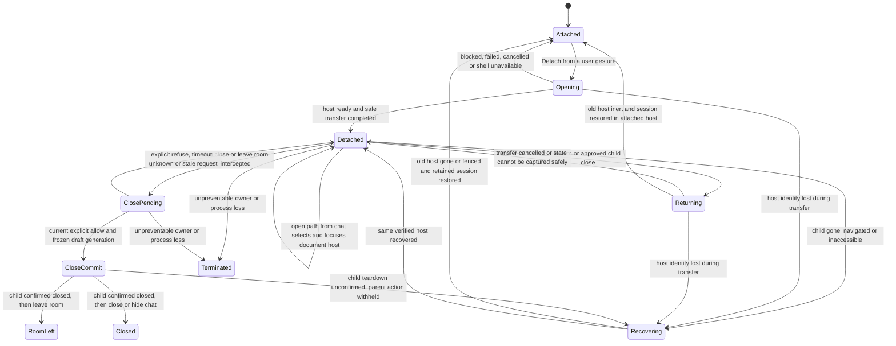
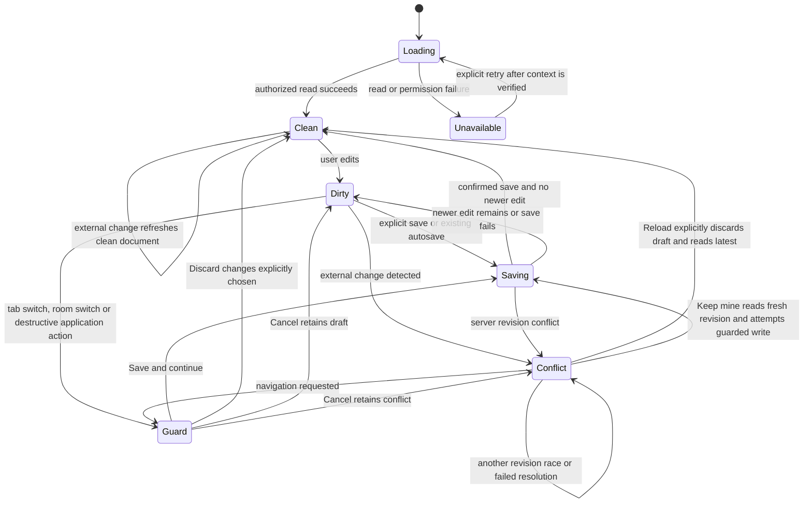
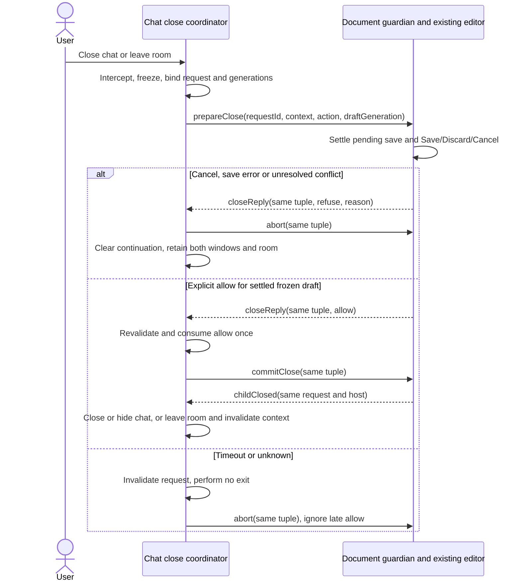

# T20 — detached document window: logic proposal

Status: proposed, updated 2026-11-10 with Sascha's dependent-window and draft-protection requirements. No overall UI, interface or logic sign-off; no authorization to implement. The diagrams describe intended behavior for discussion, not working synchronization.

## Architecture impact

Level 3: document ownership and lifecycle cross the chat-window/document-window interface in `apps/web-ui`; optional window placement touches `apps/desktop`. No product change is made here. The proposal aims to reuse existing room HTTP interfaces, React/ReactDOM and workspace policy, with no new dependency, server route, public package export or durable store. A fresh Architect must review the eventual specification after Sascha's decision is recorded in an accepted ADR.

## Authority and assumptions

- Sascha's idea: [issue #20](https://github.com/bussard76/exxperts/issues/20), including its 2026-11-10 comment: a separate later upstream series 3 depending on document-pane series 1 and editor series 2.
- Both latest entries in `~/controller-exxperts/inbox-done.md`, read 2026-11-10, order logic first, proposed ADR second, then Front questions. They prohibit building and keep series cuts parked. They do not decide the options below.
- Subsequent Sascha decision, 2026-11-10, relayed by Front in that inbox and this follow-up dispatch: the document window closes when chat closes and when leaving the room; it must not work independently. Both paths use the existing Save/Discard/Cancel protection; Cancel keeps both windows open. Unsaved Markdown must never be lost. These are product requirements, not evidence that a native termination mechanism can meet them.
- Example: `origin/agents/t16-r5-design:design/t16-close-shortcut/logic.md`. Its approved flow is not approval for T20. #16 is now deferred; neither its close accelerator nor its unresolved focus mechanism is a prerequisite.
- Accepted ADR-0002 preserves room/workspace permissions; ADR-0003 preserves local-only explicit OS opening; ADR-0004 preserves contained previews; ADR-0008 defines modules. None approves cross-window state ownership. There is no maintained `ARCHITECTURE.md` baseline.
- Open default proposal: one document window for the currently selected room/conversation of one chat-window session. Leaving the room closes it after the guard succeeds; entering another room does not silently retarget or reopen it. Window cardinality remains undecided. Multiple independent chat sessions are not globally locked by this proposal.
- Assumption: detach moves the workspace tree, workspace tabs, file previews and Markdown editor. Approval previews, task runs, attachments and room navigation remain with chat. Moving the entire shared right-pane slot would exceed the idea's document scope.

## Terms and ownership

These terms are provisional and local to this design; no project glossary is changed before agreement.

| Term | Meaning |
| --- | --- |
| Chat window | The room conversation surface and proposed lifetime owner of its document session. |
| Document session | The ordered open paths, active path, room/conversation identity, draft, baseline/revision, dirty/conflict/save status and pending guarded action for that chat session. |
| Document host | The single visible place containing the workspace tree, tabs, previews and editor: attached pane or detached window. |
| Writer | The one live Markdown editor/save pipeline for this document session; the server still arbitrates conflicting filesystem writes. |
| Return | Move the document host into the chat window without closing its tabs. Closing a tab is a separate existing action. |

Recommended exploration: keep one React owner in the chat window and render the document host into a same-origin child using ReactDOM's existing portal facility. The child is a presentation host, not a second `App`, room socket or independently writing editor. A same-origin app-served shell using the existing static entry is a candidate; a distinct server route is not presumed necessary. Bootstrap, headers and desktop popup behavior need proof before selecting the exact URL or shell.

| State | Session authority | Editor and save owner | Chat references |
| --- | --- | --- | --- |
| Attached | Chat React owner | One editor in attached host | Open via existing document selection. |
| Opening | Chat retains session and attached host | Attached editor until transfer is committed; no second editor | Serialize selection/transfer requests. |
| Detached | Chat React owner; child holds no independent canonical copy | One editor rendered in child; same room HTTP save interface | Forward to the session, select/focus child; no attached editor. |
| Returning | Chat retains session; editor controls paused | Settle in-flight work and capture latest draft before replacing host | Queue at most the current requested action. |
| Recovering | Chat retains last acknowledged in-memory session | No replacement writer until old host is confirmed gone or made inert | Show recovery action, never silently open another editor. |
| Close pending | Chat owns one correlated close request for its current owner/room/host generation | Existing editor retained; input/navigation paused while save or guard resolves | Before commit, refusal/timeout/unknown withholds both close actions in the old room; actual native prevention is a proof obligation. |

The required small prefactoring is to separate workspace-document rendering from `App.tsx`'s mixed right-pane occupants and lift recoverable editor state into the document session. Currently `MarkdownEditorPane` holds its draft internally; `MarkdownEditorHandle` exposes only save/discard/focus. A portal alone does not preserve drafts, prove native-close safety, or fix listeners bound to the wrong document. Exact internal interfaces remain for the later spec; this is not a new global store or an approval to add one.

## Window states

`ClosePending` and `CloseCommit` describe preventable application paths only. `Terminated` is an unmet-guarantee failure case, not an allowed bypass of the guard or proof of a save. Forced termination can occur from any state. A slow/backgrounded window is not dead; elapsed time alone never grants a second writer or closes either window. Native interception and teardown acknowledgement remain unproved.

## Document lifecycle

Guard cancellation restores the exact previous phase; the two Cancel arrows are conditional alternatives. A successful guard runs only the still-current pending action, once, after save completion; save error/conflict cancels continuation. Switching room, conversation or person invalidates old asynchronous results and pending actions. No file or draft is relabeled under a new room identity.

## Proposed correlated close decision

This transient interface answers how chat learns refusal; it is not implemented or accepted. It applies to both decided triggers, `chat-close` and `leave-room`. The chat owner coordinates; the document guardian runs the existing editor guard/save/conflict flow. With a portal these can be asynchronous calls within one React owner, without a BroadcastChannel or independent child state owner. Any actual cross-window/process messages must validate their known sender/origin and current window identity; the exact transport is pending feasibility review.

| Proposed request/reply field | Meaning and validation |
| --- | --- |
| `requestId` | Unique attempt identifier; echoed in allow/refuse and commit/completion. A retry after timeout gets a new ID. |
| `ownerGeneration` | New lifetime for each chat renderer/owner creation or reload; never reused by a replacement owner. |
| `roomId`, `conversationId`, `roomGeneration` | Bind the request to the current document context. Increment generation on completed leave/rebind, including return to the same room; IDs alone do not reject old replies. |
| `hostGeneration` | Changes on child replacement or document-host transfer. An old child's reply cannot authorize closing a new host. |
| `action`, `target` | Exact `chat-close` or `leave-room` continuation, including destination when relevant; never replace a pending continuation behind the same ID. |
| `draftGeneration` | Monotonic edit version, including RAW changes. The explicit allow covers only the latest settled/frozen version; an intervening edit invalidates it. |
| `decision`, `reason` | Explicit `allow` or `refuse`; refusal reason includes Cancel, save error, conflict, busy or invalidated context. Local timeout/malformed/missing reply is unknown, treated as refusal, never synthesized into allow. No file content is needed in a close reply. |

1. **Prepare before any destructive effect.** Intercept the action where the platform permits, keep both windows and the old room intact, allocate one request, and disable new edits/selections/navigation/host transfer while it is pending. Focus the existing document guard, even when initiated in chat. A clean document is not automatically safe while a save is pending or unacknowledged. Snapshot validity is checked again when an allow is received and immediately before commit.
2. **One guard and pending save.** Join the existing in-flight save rather than creating a second pipeline. Pending/unknown save keeps the request waiting or produces refuse; it never permits teardown. For dirty content show existing Save/Discard/Cancel. Save allows only after confirmed persistence of the latest draft, with no newer edits and no conflict. Save failure, permission loss or unresolved conflict returns explicit refuse and retains the draft. Reload/Keep mine retain their existing explicit meanings; resolving a conflict does not resurrect an expired close attempt. Discard is an explicit user-authorized abandonment, not accidental loss; wait for any earlier write to settle before allowing teardown, since discard cannot undo a request already sent. Cancel always replies refuse without closing/hiding either window or leaving the room.
3. **How chat learns Cancel.** The document guardian resolves `closeReply` with the request's full identity tuple and `decision: refuse, reason: cancel`; chat clears that request's continuation, acknowledges abortion to the guardian and releases its freeze. It does not poll a dirty boolean or infer approval from a missing modal/closed socket. The same path carries save/conflict refusal. If the guardian cannot be reached, chat displays that closure/room exit was not completed and retains both windows/context.
4. **Deadline/unknown fail closed.** The coordinator owns the attempt deadline; its value is a spec choice, not a clock-based grant. On timeout it invalidates the ID, withholds both actions and sends an abort for that exact tuple. The guardian may finish a save but must not close itself on a late result. Late/duplicate allows cannot execute a continuation. If abort is unacknowledged, retain the pending/frozen session and offer recovery/retry after revalidation; a timeout must not create a second live attempt. A successful save after timeout can update the old session's saved state without authorizing exit.
5. **Commit once.** Only chat may consume a current allow, once, while the exact owner/room/host/draft tuple and frozen input still match and no save/unknown write/conflict is pending. Any callback that changes the prepared draft or readiness invalidates the allow. Send a correlated commit to the guardian, keep parent close/navigation withheld, and require child-closed confirmation tied to the same host/request (or authoritative shell destruction evidence). Only then run the bound parent close/hide or room-exit continuation once and invalidate the old room/session generation. An allow is readiness, not evidence the child has closed. Missing confirmation keeps chat in place; do not label the exit successful. Before commit, timeout withholds both closes; after commit, an unknown result may mean the child already closed, so retain the owner/session for recovery without claiming both native windows are still open. Partial teardown requires recovery from retained state, not an invented atomic two-window transaction; native refusal/commit ordering is a feasibility blocker until demonstrated.
6. **Simultaneous/duplicate actions.** One coordinator serializes chat close, room exit, child close/Return and host replacement. Repeated delivery of the same request joins/replays its one pending or terminal decision without a second prompt/save/continuation. A competing different request receives explicit refuse/busy; first admitted wins, with no silent action escalation. After that attempt settles, a still-requested action must retry against the current generation. While room exit is pending a chat-close request cannot reuse its allow; while chat close is pending the child cannot close independently. If either owner/host is actually lost, stale callbacks are inert and recovery/native limitations apply. The existing single `markdownEditorPendingActionRef` must not simply be overwritten by the second action; arbitration is a required later change.

## Required guarantee and platform blockers

Sascha requires no accidental loss of unsaved Markdown on either close path, and Cancel must keep both windows open. An explicit Discard is the user's chosen exception, not permission to silently discard on error. This design must be held to that requirement; it is not met merely by using `beforeunload`, retaining an in-memory mirror, or usually saving within one second.

| Path | Required behavior | Current evidence/limit, not a waiver |
| --- | --- | --- |
| Application room exit or chat Close control | Await correlated allow; refuse/unknown means neither exit nor child closure. | Existing guard covers in-app continuations but has no correlated result/generation arbitration. No implementation or ordering proof exists yet. |
| Electron chat native ×, currently close-to-tray | Treat close intent as guarded dependent closure; after allow close child and then hide chat. Cancel leaves both visible/open. | Current handler hides immediately and does not await the editor. Tray hiding must not be used to leave the child independently open. Explicit minimize/Hide behavior needs separate scope agreement. |
| Electron quit, updater quit, reload, native child × | Intercept before teardown where supported and prove the same guard/refusal ordering for actual native entry points. | No mechanism is evidenced here; default menus, quit flags and reload/destruction can bypass an ordinary app button. #16 does not supply a proven native contract. |
| Ordinary browser tab/window close or reload | The same no-loss and Cancel contract is requested. | Generic native leave/stay prompting is platform-controlled, may be suppressed and cannot reliably await custom asynchronous Save/Discard/Cancel across windows. User-forced Leave may destroy the owner before reply or child teardown; an orphaned child cannot be trusted to detect/fence itself immediately. This is a blocker for claiming browser compliance, not an approved weaker behavior. |
| Renderer/process crash, OS kill, power loss or forced browser termination | Absolute no-loss requirement still applies unless Sascha explicitly narrows it. | A volatile owner/child cannot run a guard after termination or guarantee every unpersisted keystroke survives. No ordinary popup protocol proves immediate orphan shutdown or recovery. No crash-proof/durable store has been approved; even a proposed durable journal needs a precise acknowledged-edit guarantee and failure model. |

Fallbacks are further decisions, not implementation discretion: (A) recommended first step: authorize bounded native interception/acknowledgement feasibility work while keeping the requirement and implementation blocked; (B) approve a supported-platform/application-controlled-path scope with explicit forced/native exceptions, which narrows today's absolute requirement; (C) authorize separate durable draft-recovery architecture/evidence if recovery after termination is required, with no claim it guarantees unacknowledged keystrokes or power-loss immunity; (D) defer detaching wherever the no-loss/refusal contract cannot be met. None permits independent document operation or silent loss. No fallback is selected by this proposal.

## Saves, transfer and failures

1. **One writer:** one document host, one dirty-navigation prompt and one save pipeline per session. Both tree clicks and chat links use the same selection action. Existing independent app windows or external file editors may still race; the server revision check remains the safety net, not a session-wide lock.
2. **Save:** preserve explicit save, existing autosave, clean-file polling and read-only behavior. `PUT workspace-markdown` still sends content and expected revision under the original room/conversation/path. Never add an unconditional overwrite, new save endpoint or detach-triggered autosave rule. A lost HTTP response is not a confirmed failure to write: retain the draft and reconcile the current revision before retry/continuation. Reconnect alone does not authorize overwriting.
3. **Conflict:** Reload and Keep mine retain their existing meanings. Keep mine is explicit and still revision-checked. Failed save, lost permission, changed workspace or disconnected server retains the draft and blocks any destructive continuation. A chat WebSocket disconnect does not by itself prove HTTP saves are unavailable or that the child is dead.
4. **Host transfer:** freeze editor input and new selections, wait for existing saves to settle, and capture the latest source, baseline/revision and dirty/conflict state before removing the source host. Install one destination, restore the session, then enable input. Movement itself must not save, discard, normalize untouched Markdown or clear conflict. RAW, rich Edit and Preview must refer to the same draft. Restore focus in the destination; selection, scroll, zoom and search preservation need an explicit scope decision. If safe transfer cannot be proved, remain in the old host; offer Save/Discard/Cancel as an alternative product policy, not an implicit fallback.
5. **Detach failure:** open from the initiating click, keep the attached host until readiness is verified, and show an actionable failure if popup creation, shell initialization or transfer fails. Do not leave an empty pane, duplicate writer or endlessly open spinner. A returned handle alone is not readiness. A second click focuses the known child instead of opening another. Ignore stale completion from an earlier attempt.
6. **Leaving the room:** use the correlated protocol above, including when initiated from chat while the child is focused. Cancel/refuse/unknown keeps both windows in the old room. On allow and confirmed child closure, invalidate old requests/generations and complete the room exit; no follow/pin mode survives the old room. A later Detach in another room creates a new host generation. For a conversation-only switch within the same room, guarding and closing/reopening is the conservative proposal, not an additional Sascha decision.
7. **App-controlled Return/close:** Return keeps tabs and draft; tab × closes a tab using the existing guard. A proposed document-window Close control returns the host. Native window × is a distinct event and cannot be assumed to await an asynchronous custom save. A current in-memory draft mirror in the chat owner is required for recovery after unexpected child loss; its exact edit acknowledgement ordering must be proved before promising lossless recovery.
8. **Native dirty-close, both directions:** apply the decided dependent-close and guard contract to native paths where interception can be proved. Generic browser prompts are not equivalent to Save/Discard/Cancel and do not establish this requirement. Keep any available native warnings as additional protection; do not claim save-on-unload or a proven no-loss guarantee. The platform table above identifies blocking gaps for native close, tray hide/quit and forced destruction.
9. **Unexpected loss/reconnect:** if the owner survives, restore the last acknowledged draft into the attached host only after the original child is confirmed gone or safely fenced; keep unconfirmed-save/conflict status. Focus loss or timeout is insufficient. If the owner/process is lost, volatile unsaved work may be lost and orphan shutdown may be delayed: that violates the absolute requirement, rather than being an accepted recovery policy. No independent child writer, durable recovery, automatic replay, extra store or writer election is authorized; choose a fallback explicitly before implementation if proof cannot meet the requirement.
10. **Monitors/offscreen:** always provide Return and Show documents in chat, so reaching the child is unnecessary for recovery. Focus may be refused by a browser. Propose manual placement first: open near chat and let the user move it. Electron could later validate remembered document bounds against connected work areas; do not reuse the main window's single state file for a second window. Runtime unplug/offscreen recovery should offer Return; browser code must not claim reliable monitor detection or automatic placement. Remembering bounds is an optional product/architecture choice, not implied by existing main-window tracking.

## Feasibility evidence and required proof

Read at fork base `3fe7bc7` on 2026-11-10; these are source observations, not executed feature tests.

| Evidence | Implication for the later spec |
| --- | --- |
| `App.tsx`: `workspaceTabs`, `rightPane`, `guardMarkdownEditorAction`, `openWorkspaceMarkdown`, room identity reset | Existing central selection/guard logic can remain the owner, but the document tree is currently in the sidebar and the right pane also hosts unrelated features. |
| `MarkdownEditorPane.tsx`: internal draft/ref, save-in-flight promise, autosave, polling, `reloadLatest`/`keepMine`; `workspace-markdown-api.ts` | Reuse semantics; establish recoverable state before host replacement. Current source has no complete cross-window dirty-close protection. |
| `persistent-room-workspace-markdown-files.ts`: revision comparison and guarded replacement | Existing server protection remains authoritative in either window. No new server writer lease is presumed. |
| `MarkdownEditorPane.tsx` keyboard listener and `WorkspaceFileBrowser.tsx` visibility/focus listeners use global `document`/`window` | Bind events to the real host document/window. A child must still respond when chat is hidden or unfocused. Tooltips, overlays and drag-to-composer need the same audit. |
| `WorkspaceFramedPreview.tsx` installs its `message` listener on global `window` and checks frame source | Receive from the actual child's frame while retaining source checks, sandbox, CSP and once-only delivery. Do not weaken containment to make a portal work. |
| Desktop `wireNavigation` permits same-origin children, wires navigation/context menu; main close hides to tray | Useful existing mechanism, not proof that an empty shell, correct style/assets, child close or lifecycle is supported. Prove with the actual app. |
| Desktop `window-state.ts` restores intersecting bounds for the main window only | Does not give the proposed child saved bounds, runtime unplug handling or guaranteed visible title bar. |

A focused, separately authorized feasibility task must prove child bootstrap/CSP/assets, host-document events and TipTap behavior, correlated refusal/commit and native-close ordering, draft recovery, and preview frame delivery. In particular, hidden chat/background timer throttling must not break the visible child or turn timeout into consent. If the portal approach fails those checks, bring dependent alternatives or the explicit fallbacks back to Sascha; do not silently add a synchronization protocol/durable store, tolerate an independent child, or waive no-loss.

## Design acceptance checklist

Issue #20 has no sections named Result or Observable acceptance. The following maps every numbered work item and its three explicit questions; it is a proposal-review checklist, not a claim of implemented acceptance. Future test names are suggested public-entry scenarios, not existing or executed tests.

| Item | Design coverage | Future observable proof |
| --- | --- | --- |
| 1. Tabs, active pane, guard and draft have one owner | Ownership table and host transfer | `detach-preserves-document-session`: exact source/tabs/active path through detach and Return. |
| 2. Only document host edits; revision safety remains | Save/failure rules 1–4 | `detach-single-writer-and-conflict`: one editor/save stream; external write causes conflict. |
| 3. Chat file clicks target child if present, otherwise attached | Window diagram, rules 1/5 | `chat-open-targets-current-host`: no duplicate tab/window; attached fallback after confirmed closure. |
| 4a. Child closing and reopening; detached button | Window diagram, rules 5/7/9; Front choices | `detach-close-reopen`: native ×, Return, blocked popup, repeat click and stale opening completion. |
| 4b. Room switch | Lifecycle/close diagrams, correlated protocol, rule 6 | `detach-room-guard`: Save/Discard/Cancel, no retarget, failure, confirmed child closure, conversation-only policy and late old-generation response. |
| 4c. Monitor unplug/offscreen | Rule 10 | `detach-recover-offscreen`: recover from chat with unreachable child; desktop display-removal evidence on invented session. |
| 5. Dirty child when chat closes and vice versa | Correlated protocol, guarantee/platform blockers, rules 7–9 | `detach-dirty-close-both-directions`: Cancel keeps both open; explicit refusal, timeout/unknown/late allow, in-flight save/conflict, simultaneous chat/room/child closes, native ×/tray/quit, owner loss and chosen fallback. These tests are future proof obligations, not passed tests. |
| Question: tab strip or no strip in chat | Front Q1 (to be written after ADR) | Signed-off draft/fake demonstrates the chosen detached affordance. |
| Question: one window per room or file | Ownership assumption, Front Q2 | Signed-off cardinality and duplicate-open scenario. |
| Question: pointer/chat screen or remembered bounds | Rule 10, Front Q3 | Signed-off placement and inaccessible-child recovery scenario. |
| Later separate upstream PR on series 1 and 2 | Authority; companion Front plan to follow ADR | Clean contribution diff and standalone checks on reconciled series 1+2, after cuts resume. |

No feature tests or gate run for this design-only change. No screenshot is required to claim this written proposal complete; no captures were taken, and any later captures belong untracked under `.build/screenshots/`.
