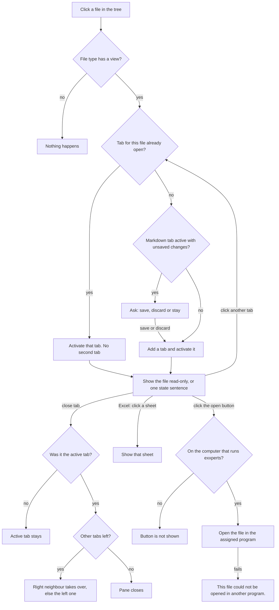

# Workspace file previews as tabs (#4)

Sign-off: stages 1 to 3 signed off by Sascha, 2026-11-05. On the draft: "figma entwurf sieht gut aus". On the question "Gibst du den Entwurf für #4 mit diesem Verhalten des Buttons frei?": "Ja, so freigeben".

Source: the Figma file "Exxperts: workspace file previews (#4)", drawn with invented data. There is no clickable fake; the unreviewed draft branch `agents/workspace-file-tabs-draft` shows the tabs working, without the file's look.

## Stage 1: surface

- `screens/01-excel-light.png`, `screens/02-excel-dark.png`: an Excel file in a tab. The sheet keeps the file's own look in both themes: fills, bold, borders, column widths, number formats. Cells show results, never formulas, and there is no formula bar. Sheets switch at the bottom. The table scrolls both ways.
- `screens/03-word-light.png`: a Word file as pages on white paper, with its headings, colours, table and image.
- `screens/04-pdf-light.png`: a PDF, its pages one below the other.
- `screens/05-image-light.png`: an image, fitted into the pane.
- `screens/06-states.png`: every state as one plain sentence.

In every screen: the open files are tabs at the top of the right pane. The active tab stands out, each tab has a cross to close it, and the tree marks the active file.

The header of every preview carries one button that opens the file in the program the operating system assigns. Its label, in Sascha's words "open in Word, Excel, open pdf oder auch open in ...": `Open in Word` for .docx, `Open in Excel` for spreadsheets, `Open PDF` for .pdf, `Open in default app` otherwise. It is hidden on paired devices, and the Markdown editor does not get it in this ticket.

Not promised by the draft: charts and unusual formatting in Excel (decided by Sascha, 2026-11-05: "ExcelJS ohne Zusatzprogramm"). The Word screen shows the goal; how faithful the chosen library renders is still to be proven with fixtures. The dark Excel screen shows sheet Q3 active with the Summary numbers; that is a shortcut of the drawing.

Files: `tree.md` is the layer tree, shortened where rows repeat. `variables.json` holds the colour tokens, taken from `apps/web-ui/src/styles/01-base.css`. No `code/` export was made.

## Stage 2: interfaces

In: a workspace-relative file path. Out: a view, or one sentence from `screens/06-states.png`. The exact route, fields and limits are the spec's to fix; the draft branch proposes `GET /api/persistent-agents/:id/workspace-preview`. Opening in another program is a second call, allowed only on the computer that runs exxperts.

## Stage 3: logic

