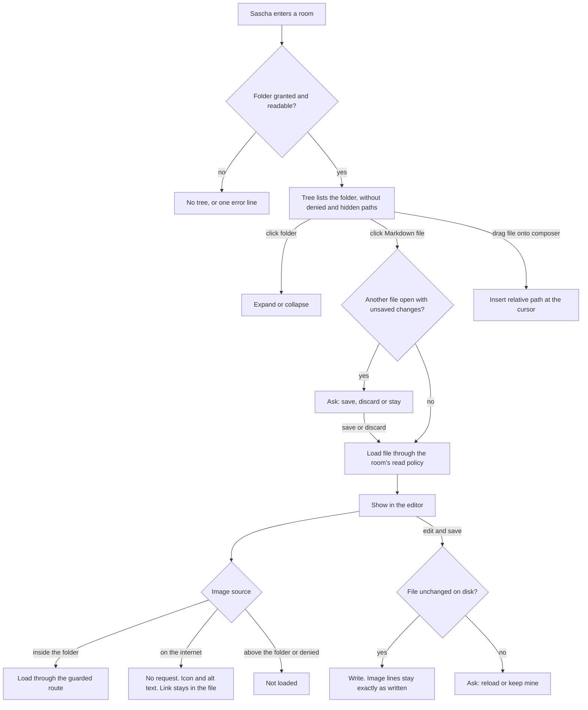

# Workspace files: tree, Markdown editor, images

Sign-off: stages 1 to 3 signed off by Sascha, 2026-11-05, answering "Gibst du Oberfläche, Schnittstellen und Logik von #5 so frei?": "Ja, so freigegeben".

No design tool was used: the screens show the running branch `feat/workspace-files` at `6ff69da`, which Sascha already tried in the Electron client, with invented data. The branch is the clickable fake.

## Stage 1: surface

- `screens/01-tree-light.png`: the room's folder as a tree in the sidebar, under Attachments.
- `screens/02-editor-with-image-light.png`: a Markdown file open on the right, with a local image shown and a blocked external image as icon and alt text.
- `screens/03-path-dragged-into-composer-light.png`: a file dragged onto the composer inserted its path.
- `screens/04-editor-with-image-dark.png`: the same in the dark theme.

States without a screen, as text: loading says "Loading…"; a room without a folder shows no tree; a folder that cannot be read shows one error line; a file type without a view does nothing on click.

## Stage 2: interfaces

The routes, fields and errors are in the spec, `docs/specs/T5-workspace-files.md` on `agents/t5-spec`. Decisions on access and external images are in ADR-0002 on `agents/t5-adr`.

## Stage 3: logic

