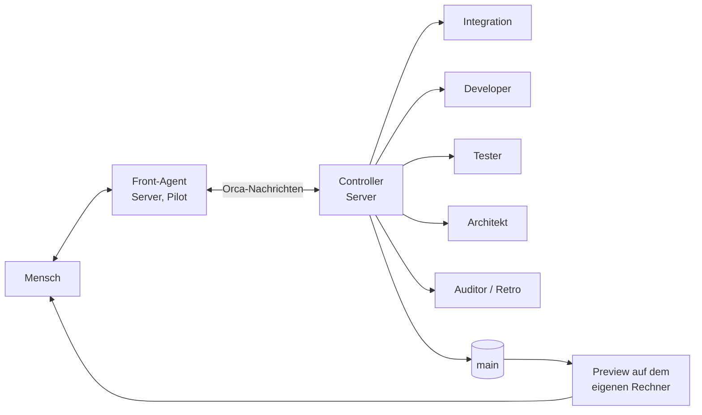
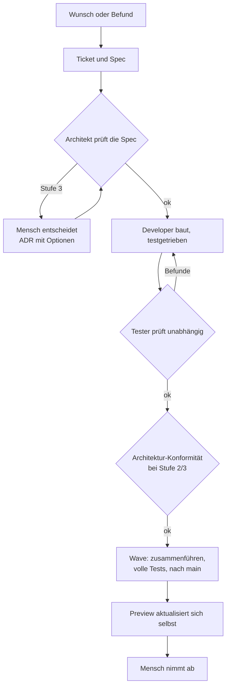
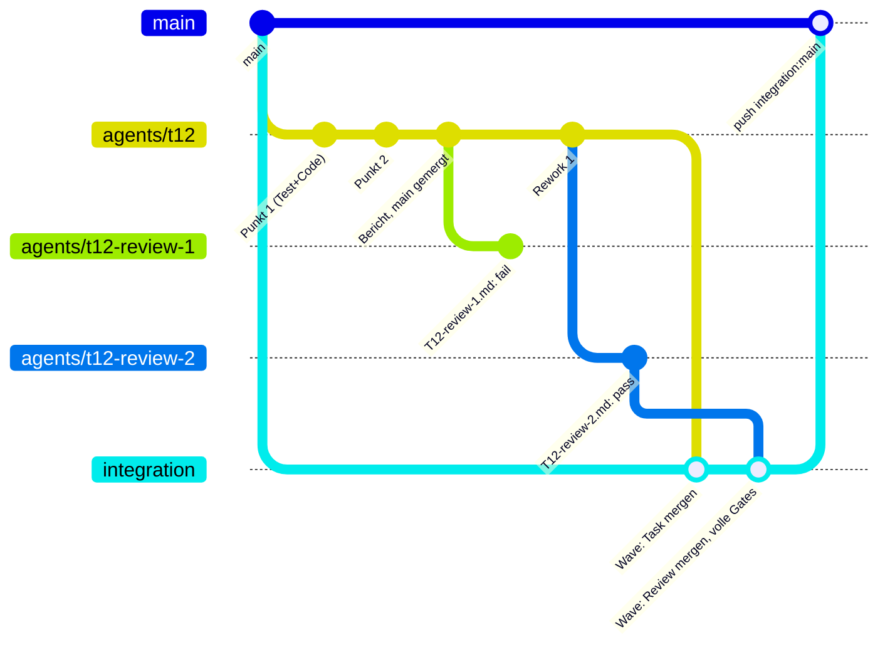

# Der Dev-Workflow: wie mit dieser Fabrik entwickelt wird

_Platzhalter in `{{…}}` füllt `init` aus; die gerenderte Fassung ist die `docs/dev-workflow.md` deines Projekts._

**Für wen:** Menschen, die verstehen wollen, wie ein Projekt mit agentic-factory gebaut wird, auch Dritte ohne Vorwissen.
**Verbindlich** für die Agenten eines Projekts sind dessen `AGENTS.md`, `docs/coordinator.md` (Regeln und Entscheidungshistorie), `docs/review-protocol.md` und `docs/architect-protocol.md`. Diese Datei fasst sie verständlich zusammen und muss mit ihnen übereinstimmen.

## Auf einen Blick

Ein Projekt wird von einer kleinen **agentischen Fabrik** gebaut:

- **Der Mensch** sagt, was gebraucht wird, testet und entscheidet. Er spricht nur mit einem Agenten, dem **Front-Agent**.
- Der **Controller** läuft unbeaufsichtigt auf einem Server. Er verteilt die Arbeit an viele **Worker** (KI-Agenten), taktet Prüfungen und bringt fertige Arbeit nach `main`, auch nachts.
- **Qualität entsteht durch Gegendruck:** Niemand nimmt seine eigene Arbeit ab. Jede Änderung prüft ein unabhängiger Tester. Git lehnt ungeprüften Code auf `main` technisch ab.

## Rollen

| Rolle | Wer / wo | Macht | Macht nie |
|---|---|---|---|
| **Mensch** | der Eigentümer | Ziele und Prioritäten, nimmt auf dem Preview ab (eigener Rechner, eigene Umgebung; automatisierte Tests nutzen nie echte Daten), entscheidet Architektur auf Stufe 3 und alles, was echte externe Systeme oder echte Daten berührt | – |
| **Front-Agent** | Agenten-Sitzung auf dem Server im Pilot | Einzige Ansprechstelle. Nimmt Wünsche und Testbefunde auf, macht daraus Tickets und Specs, führt die Stufen von außen nach innen, holt Entscheidungen ein, berichtet den Stand als Tabelle, schreibt die Morgen-Übergabe | Worker selbst steuern; den Menschen mit dem Hin und Her der Worker belasten |
| **Controller** | Agenten-Sitzung auf dem Server, unbeaufsichtigt | Startet und steuert alle Worker, taktet Tests, Reviews und Waves, erkennt hängende Worker, räumt auf, schreibt nach jedem Zyklus einen Status | Mit dem Menschen direkt sprechen; Stufe-3-Architektur, ADRs oder Produktentscheidungen treffen |
| **Developer** | Worker (Codex, Claude Code oder Pi) | Baut genau einen Auftrag, testgetrieben, auf eigenem Branch | Nach `main` pushen, Tests abschwächen |
| **Tester** | Worker, nie derselbe wie der Developer | Prüft unabhängig gegen die Spec, führt die vollen Testläufe aus, schreibt einen Befund mit Urteil | Code ändern |
| **Architekt** | Worker | Prüft Specs vor dem Bau und die Umsetzung danach gegen die Architektur | Code ändern; Stufe 3 entscheiden |
| **Auditor / Retro** | Worker, nur lesend | Wertet aus, wo die Fabrik Zeit verliert oder Fehler macht, und schlägt Verbesserungen vor | Etwas ändern |

Worker tragen Namen nach Aufgabe und Rolle, zum Beispiel „T22-S5 · Worker Developer“. Alle Namensregeln stehen in [Orca](https://github.com/bussard76/agentic-factory/blob/main/docs/orca.md#naming).

## Von außen nach innen

Neue Funktionen entstehen **von außen nach innen**. Gebaut wird erst, wenn Oberfläche, Daten und Logik mit dem Menschen abgestimmt sind.

| Stufe | Was entsteht | Werkzeug | Freigabe |
|---|---|---|---|
| **1. Oberfläche** | grafische Entwürfe im Design-Werkzeug (Figma per MCP oder Pencil), dann ein **Frontend-Fake**: durchklickbar, erfundene Daten, ein paar Dummy-Aktionen, keine echte Logik | Design-MCP, `prototype` | So sieht es aus und so bedient es sich |
| **2. Schnittstellen** | welche Daten rein- und rausgehen: Quellen, Werkzeuge, Felder, Zustände (leer, mehrdeutig, Fehler), was das System schreibt | am Fake sichtbar gemacht | Diese Daten fließen hier |
| **3. Logik** | der Ablauf in Worten und als **Ablaufdiagramm** (Mermaid) | `grilling` / `grill-with-docs` für einzelne Fragen; `prototype` (Logik-Zweig) für Verhalten, das auf Papier schwer zu beurteilen ist; `wayfinder` für größere Vorhaben über mehrere Sitzungen | So denkt und handelt das System |
| **4. Bauen** | Spec aus Stufe 1–3, Tickets, dann Architekt, Developer, Tester, Wave | `to-spec`, `to-tickets`, Controller | Abnahme auf dem Preview gegen den Fake |

- Die Stufen 1–3 erarbeitet der Front-Agent tagsüber mit dem Menschen. Der Controller baut nur, was alle drei Stufen durchlaufen hat.
- **Fehler an bereits abgestimmtem Verhalten** gehen weiter direkt als Ticket in den Bau.
- **Design-Export ins Repo:** Das Design-Werkzeug läuft nur auf dem Rechner des Menschen. Bei der Freigabe von Stufe 1 exportiert der Front-Agent Ebenenbaum, Design-Variablen, generierten Code und Screenshots nach `design/<feature>/`. Worker lesen den Entwurf aus Git und brauchen keinen Zugang zum Design-Werkzeug.
- **`wayfinder`** plant ein großes Vorhaben als Karte von Entscheidungstickets und löst sie Sitzung für Sitzung. Er plant nur, er baut nicht.
- **Grund:** Die Live-Fehler, die zu dieser Regel führten, waren fast alle Missverständnisse über Daten und Logik. Sie wären in Stufe 2 oder 3 vor dem Bau aufgefallen.

## Der Ablauf einer Aufgabe

1. **Ticket und Spec:** Ziel, Grenzen, Abnahmekriterien und **Architekturstufe**. Größere Vorhaben werden vorher in kleine, einzeln vorführbare Teile geschnitten.
2. **Architektur vor dem Bau:** Stufe 1 ist innerhalb eines Moduls. Stufe 2 ist eine neue Schnittstelle, der Controller entscheidet. Stufe 3 sind neue Verträge, Zuständigkeiten, Datenflüsse oder Technik, der **Mensch entscheidet** über einen ADR-Vorschlag mit Optionen und Empfehlung. Ein Architekt bestätigt die Stufe. Erst nach seinem „pass“ wird gebaut.

   Module clarification (ADR-0008, decided by Sascha, 2026-11-10): A new file alone is not a new module; a new module is a logically or technically wholly new topic that brings new dependencies or interfaces. Die übrigen Stufenkriterien werden gesondert geprüft.
3. **Bauen:** Ein Developer baut testgetrieben, führt eine Checkliste aller Anforderungen, pusht nach jedem Punkt und prüft am Ende seine Arbeit selbst gegen die Spec.
4. **Unabhängiger Test:** Ein anderer Worker prüft gegen die Spec und lässt die vollen Testläufe laufen (außer bei reinen Dokumentationsänderungen). Befunde gehen an den Developer zurück, danach prüft ein neuer Tester.
5. **Konformität:** Bei Stufe 2 und 3 prüft ein Architekt grob, ob der Code die entschiedene Architektur umsetzt.
6. **Wave:** Der Controller sammelt bestandene Aufgaben und führt sie zusammen. Auf dem gemeinsamen Stand laufen noch einmal alle Tests, dann geht der Stand nach `main`. Eine Wave startet, sobald zwei Aufgaben warten, eine 60 Minuten wartet oder eine Aufgabe andere blockiert. Wenn sonst nichts in der Warteschlange liegt oder läuft, beginnt die Integration sofort (entschieden von Sascha am 09.11.2026).
7. **Abnahme:** Der Preview zieht den neuen `main` automatisch. Der Mensch testet dort in seiner eigenen Umgebung, auf einer privaten Kopie, wo Daten im Spiel sind. Befunde werden neue Tickets.

**Fehler** laufen denselben Weg. Zuerst muss ein Test den Fehler zeigen, ohne Nachstellung gibt es keinen Fix.

## Branches und Worktrees: die Mechanik eines Tickets

Jedes Ticket, ob GitHub-Issue oder Task-Datei, wird zu genau einem Branch und einem Worktree pro Worker. Im Haupt-Checkout wird nie gebaut.

| Schritt | Wer | Wo | Was passiert |
|---|---|---|---|
| 1. Ticket ist `ready` | Front-Agent | Issue `#12` oder `docs/tasks/T12-<slug>.md` | Ziel, Outside-in-Nachweise, Stufe, Abnahme; auf Konflikte mit den Projektregeln geprüft; eine Zeile in `inbox.md` |
| 2. Spec-Review | Architekt (nur lesend) | Branch `agents/t12-specreview` von `main` | committet nur `docs/reviews/T12-architecture-spec.md`; `Verdict: pass` |
| 3. Bauen | Developer | **neuer Worktree** `<workspaces>/<projekt>/t12/` auf **neuem Branch** `agents/t12` von `origin/main` | Checkliste aller Abnahmepunkte im Bericht; Punkt für Punkt: fehlschlagender Test, Umsetzung, Commit, **Push nach jedem Punkt**; nur gezielte Prüfungen; Selbst-Review gegen die Spec; am Ende `origin/main` hereinmergen; Bericht `docs/reports/T12-….md`; `worker_done` mit Branch und SHA |
| 4. Review Runde 1 | Tester (frischer Kontext, nur lesend) | temporärer Branch vom geprüften SHA mit hereingemergtem `origin/main`; Befund auf `agents/t12-review-1` | lässt die vollen Gates selbst über `gate` laufen (außer bei reinen Dokumentationsänderungen); prüft die Abläufe; committet nur `docs/reviews/T12-review-1.md` mit `Reviewed commit: <SHA>` und `Verdict` |
| 5a. `fail` | Developer | **derselbe Worktree und Branch** `agents/t12` | behebt jeden Befund testgetrieben, committet, pusht; „Rework 1“ im Bericht; ein neuer Tester schreibt `T12-review-2.md` auf `agents/t12-review-2` |
| 5b. `pass` | Architekt (nur Stufe 2/3) | `agents/t12-conformance` vom bestandenen SHA | grobe Grenzprüfung, `T12-architecture-conformance.md` |
| 6. Wave | Controller | Worktree `<workspaces>/<projekt>/coordinator-integration/`, Branch `integration` auf `origin/main` zurückgesetzt | führt jeden bestandenen Task-Branch **zusammen mit dem Review-Branch seiner bestandenen Runde** zusammen (`agents/t12` und `agents/t12-review-2`, bei Stufe 2/3 auch den Konformitäts-Branch), einen Branch nach dem anderen (einen Octopus-Merge lehnt die Push-Sperre ab), übernimmt die ADR-Verweise der gemergten Commits in die Merge-Nachricht, lässt die vollen Gates einmal laufen (außer bei reinen Dokumentationsänderungen), **pusht `integration` nach `main`**; der Pre-Push-Hook prüft, dass jeder Commit Vorfahre eines `Verdict: pass`-Review-SHA ist, dessen Befunddatei im gepushten Stand liegt |
| 7. Preview und Abnahme | Mensch | der Preview-Klon auf dem eigenen Rechner | folgt `main` automatisch; Befunde werden neue Tickets |
| 8. Aufräumen | Controller, jeder Zyklus | alle Worker-Hosts | schließt das Terminal des Workers, gibt den Dispatch frei, entfernt den Worktree `t12/`, sobald sein Branch gemergt oder sicher auf origin ist, löscht gemergte `agents/t12*`-Branches, schließt das Issue oder setzt `Status: integrated` |

Regeln, die das sicher machen:

- **Ein Worker, ein Worktree, ein Branch.** Mehrere Tickets laufen parallel, weil sich ihre Worktrees nicht berühren. Der Controller ändert nie Git-Zustand im Worktree eines laufenden Workers. Auf dem Host des Controllers ist der Worktree eines Workers in Orca ein Kind des Controller-Workspace; auf einem anderen Host steht er für sich.
- **Push nach jedem Punkt.** Ein Server-Neustart verliert nichts; der Controller startet den Worker in seinem Worktree mit einer Fortsetzungs-Anweisung neu.
- **Review-Branches werden nie überschrieben.** Die Rundennummer steht im Namen, so bleibt die Geschichte eines Tickets vollständig.
- **Worker pushen nie nach `main`.** Das tut nur die Wave, und nur mit der Review-Deckung, die der Hook prüft.
- **Branch-Namen tragen das Ticket:** `agents/t12`, `agents/t12-review-<n>`, `agents/t12-conformance`, `agents/t12-specreview`. Das Präfix kommt aus `project.branchPrefix`. Im Issue-Modus ist die Nummer die Issue-Nummer.
- **Worktree-Namen tragen das Ticket ebenfalls.** `ls <workspaces>/<projekt>` ist damit die Liste der laufenden Arbeit. Mehr Einträge als Aufgaben plus ein paar bedeutet: Aufräumen ist überfällig.

## Wann was geprüft wird

| Stufe | Wer | Was |
|---|---|---|
| Beim Bauen | Developer | gezielt: Typen, Lint, die betroffenen Tests, die Browser-Tests zur eigenen Änderung |
| Pro Aufgabe | Tester | **voll**: Verify und Browser-Tests auf „aktuelles main plus Branch“; reine Dokumentationsänderungen ohne volles Gate |
| Pro Wave | Controller | **voll** auf dem zusammengeführten Stand, dann Push nach `main`; reine Dokumentationsänderungen ohne volles Gate |
| Beim Release (nur auf Zuruf) | Release-Gate | zusätzlich Docker-Prüfungen, die **Sicherheits- und Lasttests** und die Browser-Abnahme über die echten Adressen |

**Volle Gates** laufen auf workhorse2: eines gleichzeitig auf dem Host, darin laufen die Smokes parallel mit dem Standard des Runners (dort sechs gleichzeitig). Aufruf: `GATE_SLOTS=1 gate bash -c 'npm run build && npm run smokes'`. Jeder im parallelen Lauf gescheiterte Smoke wird auf demselben Commit allein wiederholt; beide Ergebnisse werden berichtet, während andere Arbeit weiterläuft. Reine Dokumentationsänderungen erhalten kein volles Gate (decided by Sascha, 2026-11-06: „Weiter auf workhorse2“ und „inwieweit es möglich ist, die Tests zu parallelisieren und nicht seriell hintereinander auszuführen ... Wenn die Testausführung so lange dauert, ist das negativ“).

Der Controller setzt für jeden vollen Gate-Aufruf `GATE_SLOTS=1`, auch für Browser-Gates, und für Browser-Gates zusätzlich `GATE_E2E_SLOTS=1`, da der Browser-Pool diese Variable liest. Der allgemeine Aufruf lautet `GATE_SLOTS=1 GATE_E2E_SLOTS=1 gate bash -c '<command>'`; im Projekt `exxperts` wählt der Shim anhand von `factory.config.json` `~/controller-exxperts/gate.mjs` (decided by Sascha, 2026-11-07: “yes, this project only”). Der Controller koordiniert volle Gates auf dem gesamten Host: Aufrufe mit höheren Slot-Werten können überlappen und Unit- und Browser-Pools sind getrennt. Die Slot-Einstellungen allein erzwingen daher die hostweite Grenze nicht.

**Nur funktional prüfen:** Ein Review scheitert nur an echten Funktionsfehlern: Ein Ablauf aus der Spec läuft nicht oder liefert falsche Ergebnisse, Daten gehen verloren, oder eine Änderung würde ein echtes externes System erreichen. Fehlende Tests, Abdeckungslücken, Randfälle, Sicherheit, Last und Stil werden Schulden mit Folgeaufgabe und blockieren nichts. Nach höchstens 2 Review-Runden (`reviews.maxRounds` des Projekts) wird integriert, wenn die Funktion läuft. **Nichts davon entfällt:** Die Schulden werden mit Kategorie gesammelt und in einer eigenen **Härtungsphase** abgearbeitet, sobald funktional eine gewisse Breite erreicht ist. Der Mensch startet sie, der Front-Agent schlägt sie vor. **Läuft immer mit:** Code-Qualität (`ponytail-review`, Coding Standards) und Architektur-Einhaltung werden in jedem Review geprüft; ein Architekturverstoß blockiert, Qualitätsbefunde werden behoben, wenn trivial, sonst Schuld. **Nicht im Alltag, zwingend vor dem Release:** Last-, Sicherheits- und die übrigen zurückgestellten Prüfungen bremsen die Entwicklung (Beobachtung), darum laufen sie in der Härtungsphase und vor jedem Release, als Bedingung der Freigabe. Kein Release, solange eine solche Schuld offen ist, es sei denn, der Mensch nimmt sie ausdrücklich schriftlich in Kauf. Ausnahme im Alltag: Alles, was ein echtes externes System erreichen könnte, bleibt sofort ein Blocker.

**Push-Sperre:** Git lehnt jeden Push nach `main` ab, der nicht durch ein bestandenes unabhängiges Review gedeckt ist. Architekturänderungen brauchen zusätzlich ihre Freigabe. Enforced by the factory hooks in `.githooks/` (`tools/factory-guardrails.mjs`). With the hooks armed (`core.hooksPath=.githooks`), `pre-push` checks every update of `main`.

**Realistische Testdaten:** Die Demo-Daten bilden die *Formen* der echten Daten mit erfundenen Inhalten nach. Fehler, die erst beim Menschen auffallen, hatten fast immer zu ordentliche Testdaten als Ursache.

## Wo was läuft

| Ort | Was |
|---|---|
| **Worker-Hosts** | null bis viele Server oder der eigene Rechner: Worker, Testläufe, Waves. Ein Remote-Server ist eine Option, kein Muss; mehrere sind möglich |
| **Controller-Host** | einer der Worker-Hosts oder der Rechner des Menschen; im Pilot auch der Front-Agent |
| **Rechner des Menschen** | der **Preview**: der aktuelle `main` mit der echten Umgebung, nur lesend, auf einer privaten Kopie der Daten, wo Daten im Spiel sind; Mac-Worker für Mac-only-Arbeit |
| **Git-Host** | das Repository; alle Worker-Branches landen dort, nie direkt auf `main` |

- **Kapazität nach Messung und Kalibrierung:** Der Controller startet Worker nach gemessener Last (CPU-, Speicher- und I/O-Wartezeit, verfügbarer RAM, Gate-Warteschlange, fremde Last, Kontingente), nicht nach fester Anzahl. Die Obergrenzen pro Host sind Startwerte: Sie steigen schrittweise, solange der Host ruhig bleibt, und sinken bei Druck; der Audit prüft die Schritte. Die Gate-Plätze passen sich an. Bei Engpass gilt: kritischer Pfad, fast fertige Aufgaben, Waves, neue Entwicklung, Schuldenabbau.
- **Gates:** Testläufe gehen über `gate`, fair in Reihenfolge, getrennt nach Unit- und Browser-Tests.
- **Lastlog:** schreibt jede Minute Last, Speicher und Wartezeiten mit.

## Modelle

| Stufe | Wofür |
|---|---|
| Standard | Entwicklung, alle Tester, Spec- und Architektur-Prüfungen |
| klein | Mechanisches nach Checkliste |
| groß | ADRs und Architektur auf Stufe 3 |

**Eskalationsleiter:** Scheitert ein Worker zweimal an derselben Aufgabe, läuft der nächste Versuch eine Stufe höher. **Kontingent:** Worker bleiben unabhängig vom Wochenlimit bei den OpenAI-Modellen; kein Claude-Fallback. Bei knappem oder erreichtem Limit pusht der Controller den aktuellen Stand und bittet Sascha in `status.md` um den Reset mit Credits. Der Controller spart kein Kontingent durch serielle Arbeit und wartet nicht auf einen Kalendertag. **Kalibrierung:** Die Stufe pro Rolle ist ein Startwert. Bestehensquote und Runden aus dem Journal setzen eine Rolle herab, wenn sie leicht besteht, und herauf, wenn sich Fehlschläge häufen. (Entschieden von Sascha am 06.11.2026.)

Aufträge folgen festen **Vorlagen pro Rolle**: nummerierte Schritte, „fertig wenn“, Abbruchkriterien, Antwortformat. Jede Spec wird aus der Vorlage mit Parametern erzeugt, nie durch Abwandeln der Spec einer anderen Aufgabe.

## Zusammenarbeit mit dem Menschen

Der Rhythmus ist eine Einstellung (`rhythm.mode`), keine Regel:

- **Tags planen, nachts bauen** (Standard im Ursprungsprojekt): Tagsüber testet der Mensch auf dem Preview und bespricht mit dem Front-Agent, Befunde werden sofort Tickets. Nachts arbeitet der Controller allein. Morgens gibt es eine Übergabe mit neuem Stand, offenen Fragen und Abnahmen.
- **Durchgehend:** Der Controller baut, sobald freigegebene Arbeit da ist, und fragt, wenn Fragen entstehen.
- **Eigener Zeitplan:** Ruhezeiten legen fest, wann der Controller neue Arbeit starten darf.
- **Status auf Nachfrage:** eine Tabelle mit Aufgabe, wer daran arbeitet (Rolle, Modell), Stand, nächster Schritt und ob der Mensch gebraucht wird. Darunter, was neu auf `main` ist, und offene Abnahmen.
- **Fragen an den Menschen:** immer eine auf einmal, mit Optionen und Empfehlung.
- **Schnittstelle Front-Agent ↔ Controller:** Im manuellen Server-Pilot (entschieden von Sascha am 10.11.2026) laufen beide im selben Orca und senden Aufträge und Antworten in beide Richtungen mit `orca orchestration send`. Der Controller schreibt Ereignisse für den Front-Agent in `front-events.log`: nur anhängen, nie archivieren. `inbox.md` und `status.md` bleiben Rückfallweg und Dokumentation; `CONTROLLER.md` ist das Betriebshandbuch. Der Baum ist Front → Controller → Integration und Worker; der Controller steuert die Worker. Mac-only-Arbeit trägt der Front-Agent in `~/front-exxperts/mac-tasks.log` für einen Mac-Worker ein, der das Ergebnis per Orca an den Server-Front-Agent zurücksendet. Ist der Mac aus, wartet die Aufgabe. Der Server wird nicht mit dem Mac gekoppelt; private Arbeitsdaten bleiben vom Build-Server fern. Automatischer Start, Baumaufbau und Mac-Task-Watcher sind noch nicht implementiert; ein leeres Log belegt keine Zustellung.
- **Node-Vergleich und Eskalationen (entschieden von Sascha, 10.11.2026):** Für jede Serie zählt auf Node 20.6 und 22 ein Fehler als bestanden, wenn derselbe Smoke auf der gepinnten Upstream-Baseline `461e6485bf932f5cba85ac3dde8e0104e47d5dec` und der Serie denselben Fehler zeigt. Die jeweilige PR-Beschreibung nennt ihn als vorbestehendes Upstream-Verhalten. Ein nur in der Serie auftretender Fehler ist ein echter Defekt; fehlende, übersprungene, unvollständige oder nicht vergleichbare Evidenz bleibt offen. Alle anderen Gate-Regeln gelten weiter. Vor einer Eskalation prüft der Controller die Abbruchkriterien des Tickets und Saschas dokumentierte Entscheidungen; nur ungeklärte Fragen werden weitergegeben, mit den geprüften Entscheidungen und dem Grund, warum sie nicht passen. Jede `NEEDS-SASCHA`- oder `BLOCKED`-Zeile bleibt im append-only `front-events.log`; die Frage oder Blockade wird außerdem sofort mit `orca orchestration send --to term_6eae3083-5398-4d94-85e5-57a8f00d7065` an Front gesendet. Status und Rückfallwege bleiben bestehen.

## Der Zyklus des Controllers

Bei jedem Ereignis eines Workers, sonst alle 10 Minuten:

1. **Ereignisse und Promptzustand lesen:** Fertigmeldungen, Fragen und Eskalationen, neue Einträge in `inbox.md`, aktueller `main`. Bei jedem Heartbeat prüft der Controller zusätzlich den angezeigten Prompt jedes aktiven Worker-Terminals. Ein lebender Orca-Dispatch beweist nicht, dass der Agent arbeitet. Steht er am Eingabeprompt, liest der Controller die letzte Ausgabe, sendet einen konkreten Fortsetzungsauftrag über Orca und ins Terminal und bestätigt den gestarteten Turn.
2. **Reagieren:** Developer fertig → Tester. Tester gescheitert → Nacharbeit im selben Worktree, nach zwei Fehlschlägen eine Modellstufe höher, nach der Rundengrenze Frage an den Menschen. Tester bestanden → bei Stufe 2/3 Konformität, sonst nächste Wave. Frage eines Workers → selbst entscheiden, wenn durch Regeln gedeckt, und schriftlich festhalten; sonst Frage an den Menschen.
3. **Hänger erkennen:** Eine Stall-Watch prüft alle Worker-Terminals. Ein Worker, der still am Prompt steht, „Modell überlastet“ meldet oder vorzeitig aufhört, bekommt einen Anstoß direkt ins Terminal. Beobachteten Promptzustand und bestätigtes Aufwecken dokumentiert der Controller in `status.md`.
4. **Freie Plätze füllen:** nach dem Kapazitäts-Urteil und der Reihenfolge bei Engpass.
5. **Aufräumen, in jedem Zyklus:** Terminals fertiger Worker schließen, Worker freigeben, Worktrees mit gemergtem oder sicher gepushtem Branch entfernen (ungesicherte Änderungen vorher als WIP-Branch pushen), gemergte Branches löschen. Worktrees aktiver oder pausierter Aufgaben bleiben.
6. **Status schreiben:** `status.md` mit Zeitstempel.

## Umgang mit Störungen

- **Tests unter Last:** Für fehlgeschlagene parallele Smokes gilt die Regel für volle Gates oben. Andere bekannte Wackler dürfen ein Mal einzeln wiederholt werden; dreimal allein grün gilt als Nachweis. Im Review lässt ein unveränderter Test, der nur unter Last per Timeout scheitert, die Aufgabe nicht durchfallen. Ursachen werden in eigenen Aufgaben behoben, nie durch schwächere Tests.
- **Fremde Störungen:** Ein anderes Projekt auf demselben Server kann Netzwechsel verursachen. Solche Läufe gelten als Umgebungsproblem und werden wiederholt. Das andere Projekt wird nie angefasst.
- **Merge-Konflikte in der Wave:** Der Developer der Aufgabe löst sie auf seinem Branch, ein Tester prüft die Auflösung.
- **Server-Neustart:** Alle Agenten sind weg. Der Controller prüft jeden Worktree und startet die Worker im selben Worktree mit einer Fortsetzungs-Anweisung neu. Weil jeder Worker regelmäßig pusht, geht nichts verloren.
- **Fehler, die erst beim Menschen auffallen:** sofort Ticket und Retro-Anlass. Die fehlende Datenform kommt in die Demo-Daten.

## Konventionen

- **Nummern:** Tickets heißen `T<n>`, jede Nummer gibt es genau einmal. ADR-Nummern genauso.
- **Branches:** pro Aufgabe einer; Review-Branches tragen Aufgabe und Runde und werden nie überschrieben.
- **Berichte und Befunde:** `docs/reports/T<n>-….md` vom Developer, `docs/reviews/T<n>-review-<runde>.md` vom Tester, `docs/reviews/<T>-architecture-….md` vom Architekten.
- **Screenshots:** bleiben unversioniert unter `.build/screenshots/` und stehen im Bericht.
- **Entscheidungen:** sofort schriftlich, mit „decided by“ und Datum, in `docs/coordinator.md` und in dieser Datei.

## Die Fabrik verbessert sich selbst

- **Series priority (decided by Sascha, 2026-11-10):** Upstream Series 1 and 2 are the first priority; #20 detached-document-window is secondary. Do not start T20 hardening or use T20 documentation slots that series work can use; current T20 work may finish its present step then park. Prioritize #22 lock delta, Node floor and licences, Series 1 consult-mention and notice/artifact evidence, Series 2 #17/#18 addendum and CSS, composition, gates and sendable state for Sascha. This decision does not grant permission to write to EXXETA.
- **Ereignisjournal:** jedes Ereignis mit Ursache: Start, Ergebnis, Review-Runde, Wiederholung, Hänger, Wave, Gate-Wartezeit.
- **Tester- und Integrations-Gates:** Eine grüne Integration reicht für den Push, auch wenn parallele Smoke-Ausreißer aus dem Tester-Lauf einzeln bestanden haben. Jeder Ausreißer und beide Ergebnisse stehen im Review. Ein einzeln fehlschlagender Smoke oder ein rotes Integrations-Gate bleibt ein Blocker (entschieden von Sascha am 07.11.2026, am 09.11.2026 bestätigt: „Grüne Integration reicht“).
- **Upstream und Excalidraw:** Ein Upstream-Pull-Request ist später vorgesehen, wird jetzt aber weder vorbereitet noch an `EXXETA/exxperts` gesendet. Excalidraw bleibt ausschließlich im Fork und muss so getrennt bleiben, dass es bei einem späteren Upstream-Port entfallen kann (entschieden von Sascha am 09.11.2026).
- **Pipeline-Auditor:** jede Nacht nach der letzten Wave und sofort bei Häufungen. Liest Journal, Lastlog, Reviews, Schulden und Regeln. Fragt, wo Zeit verloren geht, welche Fehlerursachen sich häufen, welche Regeln Nacharbeit erzeugen, welche Risiken wachsen und ob die letzten Verbesserungen gewirkt haben. Liefert eine Seite mit den drei wichtigsten Verbesserungen und Risiken, jeweils mit Messwert, Ursache, Vorschlag und prüfbarem Erfolgskriterium.
- **Retro pro Agentenlauf** mit dem `retro`-Skill: nach zwei Fehlrunden, vorzeitigem Abbruch, zwei Hängern oder wiederholten eigenen Fehlern liest ein Retro-Worker das Sitzungsprotokoll und schlägt 1–3 belegte Verbesserungen an der Arbeitsumgebung vor. Neue Regeln kommen nie in `AGENTS.md`, neue Checks werden erst getestet.
- **Schnellspur:** Kleine Verbesserungen (Doku, Vorlagen, Skripte, Tests) setzt der Controller selbst um, höchstens eine gleichzeitig. Die nächste Auswertung prüft die Wirkung.
- **Altlasten-Register** `docs/debt.md`: jede bekannte Schuld mit Risiko und Vorschlag. Etwa ein Fünftel der Arbeit geht in den Abbau, die Härtungsphase nimmt Sicherheit, Last und Tests gesammelt.

## Feste Regeln, die nie verhandelt werden

- **Die Fabrik wirkt nicht nach außen.** Agenten und ihre Tests verändern nichts außerhalb von Repository und Demo- oder Testumgebung: keine Produktivsysteme, keine echten Konten, keine echten Daten, kein Senden, Deployen oder Löschen. Ob und wie das *Produkt* auf externe Systeme wirkt, ist eine Produktentscheidung des Projekts.
- **Echte Daten unantastbar:** Tests laufen im Demo oder auf einer privaten Kopie. Im Original wird nie geschrieben oder gelöscht.
- **Keine echten Daten im Repo:** keine Firmenwerte, Namen, Adressen oder Geheimnisse in Code, Tests, Fixtures oder Berichten. `.env` wird nie committet, Geheimnisse werden nie ausgegeben.
- **Worker pushen nie nach `main`.**
- **Keine Hooks umgehen:** `--no-verify` ist verboten, und jeder andere Weg daran vorbei ebenso (`HUSKY=0`, `core.hooksPath` ändern, `git -c core.hooksPath=…`).
- **Keine echten Modellaufrufe in Tests.**

## Werkzeuge und Skills

| Was | Wofür |
|---|---|
| **Orca** oder einfache Terminals | Worker in eigenen Worktrees starten; Nachrichten zwischen Controller und Workern |
| **Git-Hooks** | Commit: Secret-Scan, geschützte Dateien nur mit ADR. Push nach `main`: bestandenes Review nötig |
| **Spec-Vorlagen** | einheitliche Aufträge pro Rolle |
| **`gate`, Lastlog, Stall-Watch, `capacity.mjs`** | faire Testläufe, Messung, hängende Worker, Kapazität nach Messung |
| **Preview-Updater** | hält den lokalen Preview auf dem aktuellen `main` |
| **ADRs** | jede Architekturentscheidung mit Begründung und „Decided by“ |

| Skill | Wofür | Wer |
|---|---|---|
| `grilling`, `grill-with-docs`, `domain-modeling`, `wayfinder`, `to-spec`, `to-tickets`, `prototype` | klären, Begriffe, planen, zuschneiden, Fake bauen | Front-Agent mit dem Menschen |
| `tdd`, `diagnosing-bugs`, `ponytail` | testgetrieben und schlank bauen, Fehler nachstellen | Developer |
| `ponytail-review`, `code-review` | unabhängig prüfen | Tester |
| `ponytail-audit` | Architektur-Check | Architekt |
| `ponytail-debt` | Schuldenbuch für die Härtungsphase | Controller, Auditor |
| `retro` | Verbesserung der Agenten-Umgebung nach schwierigen Läufen | Retro-Worker |
| `handoff`, `writing-for-agents` | Übergaben, Aufträge und Regeln schreiben | Front-Agent, Controller |

Die Skills liegen fest versioniert unter `.agents/skills/`. Fremde Skills werden vor der Aufnahme vollständig gelesen.

## Woher die Regeln kommen

**Diese Datei wird immer nachgehalten:** Jede neue Entscheidung zur Arbeitsweise kommt sofort hier hinein, verständlich für Dritte, und zusätzlich mit Details in `docs/coordinator.md`. Jede Regel geht auf eine Entscheidung mit Datum und Begründung zurück.
