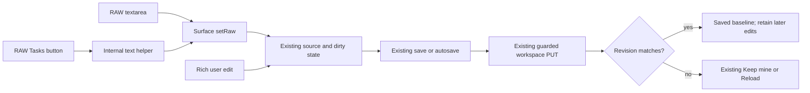

# T17-18-RECLASS architecture spec

Verdict: pass
Reviewed commit: 028012127b8686ac0215fe30a4f3d3c3bb2af742
Spec: fork issues [#17](https://github.com/bussard76/exxperts/issues/17) and [#18](https://github.com/bussard76/exxperts/issues/18), read 2026-11-10; Controller `~/controller-exxperts/specs/t17-18-reclass-specreview.txt` SHA-256 `bbf66e395a5a16cf1a859c5ef11edbe686c3e5dae867cb3b273b5b78417073e6`; original addendum `~/controller-exxperts/specs/series-2-raw-tasks-addendum.md` SHA-256 `ea0b81e37db130af0ba80f25974a553ab2634fd684ca7a733079db1c8797323d`.
Level: **1 for #17 and #18**, reclassified against the exact implementation using Sascha's corrected module definition of 2026-11-10.
Decision: recorded in `~/controller-exxperts/inbox-done.md`, heading “Sascha CORRECTS the module question”: a new file is not automatically a new module; a module is a logically or technically new topic that brings new dependencies. No level-2 decision or level-3 ADR is required for this implementation. ADR-0007 and its acceptance are superseded; neither is authorization for this verdict, and neither should be merged for this task.

## Architecture impact

Both issues remain inside the existing Markdown editing module. #17 adds editable RAW text to its existing draft, dirty, save and conflict machinery. #18 adds text-only task operations, the internal toolbar prop, and recognition of rich checkbox clicks as user edits. Pane sizing and checkbox alignment remain local presentation changes.

Independent inspection of the complete six-file diff against `9111063fdd58ad96ad27f9bd1967dbe5a8de2a13` confirms no changed package manifest or lockfile, server implementation, route, remote policy, durable store or workspace contract. The existing browser → guarded room routes → granted workspace flow remains the same. `MarkdownEditorPane`'s props and external `MarkdownEditorHandle` (`save`, `discard`, `focus`) are unchanged.

`apps/web-ui/src/markdown-raw-tasks.ts` has **no imports or dependencies**. Its only production consumer is `MarkdownEditorPane.tsx:25`; `markdown-raw-tasks-smoke.ts:3` is the additional test consumer. Its two function exports and `TaskToggleResult` type are internal to Markdown editing, with no package-level public export or consumer in another product topic. Likewise, `MarkdownEditorToolbar`'s optional RAW prop is consumed only through the pane's private surface. TypeScript file exports and an internal seam do not establish a new architectural module under Sascha's corrected definition.

This supersedes the level-3 conclusion and the fold-helper/obtain-ADR alternatives in `42bca9d4e9eb09f09a1ae3670c103c7b42742b16` (`docs/reviews/T17-18-ADDENDUM-architecture-spec.md`). That report correctly described the internal seams but treated the new helper file and its exports as a new module. No implementation change is needed to resolve that finding.

## Fit checklist

| Requirement | Owning module and seam | Boundary/data flow | Evidence or disposition |
| --- | --- | --- | --- |
| #17 editable RAW and mode switches | Markdown editing; private `SurfaceHandle.setRaw(text: string): void`, `leaveRaw(): void`, `getContent(): string` | Textarea edits update the exact source and pane draft; leaving RAW loads TipTap without treating the load as a user edit | `MarkdownEditorPane.tsx:103–112,153–218,286–313,559–571,629`. Exact RAW text is retained until an actual rich edit; switching alone must remain clean. No external interface changes. |
| Save, conflict and dirty navigation | Existing surface save loop, pane `persist`, `useMarkdownEditorSync`, App navigation guard | Same `save()` and dirty callback as Edit; save completion advances baseline/revision while retaining later edits; Keep mine uses the latest revision | `MarkdownEditorPane.tsx:223–258,425–432,500–520,574–603`; App still calls the same handle for save/discard. Existing phases are `loading`, `ready`, `saving`, `conflict`, `error`. Save failure retains the draft. No second persistence path. |
| #18 task transformation and selection | Internal helper → pane → toolbar | `cycleTaskLines(value: string, start: number, end: number): TaskToggleResult`, where result is `{ value: string; selectionStart: number; selectionEnd: number }`; `isTaskLine(value: string, position: number): boolean` | DOM textarea offsets supply inputs; the pane applies returned text through `setRaw` and restores the selection. Each selected nonempty line independently cycles plain/bullet → unchecked → checked → unchecked; indentation and existing bullet are retained. A selection ending at the next line's start excludes that line; caret-only use changes its line. |
| Empty and ambiguous states | Helper and pane selection owner | Empty/whitespace-only blocks return unchanged text and selection; blank lines in a mixed selection stay blank; checked `x`/`X` count as checked | `markdown-raw-tasks.ts:11–51`. Interpretation is #18 reading 1 plus verification of Edit checkbox saving; unrelated RAW formatting actions are outside scope. No unresolved choice requires a new design. |
| Task active state and toolbar restrictions | Internal `raw?: { taskActive: boolean; onTask: () => void }` on surface/toolbar | Pane derives active state from the caret line; task callback operates on visible RAW text; ordinary rich commands are disabled | `MarkdownEditorPane.tsx:419–422,526–543,628–629`; `MarkdownEditorToolbar.tsx:23–24,74–100`. RAW disables Undo, Redo, paragraph, H1–H3, blockquote, bold, italic, strike, inline code, link, bullet/numbered lists, Find, Insert table and Copy. Save keeps existing dirty/saving/conflict restrictions. Delete table visibility remains accepted debt. |
| Existing workspace contract and bounds | `workspace-markdown-api.ts`; `room-settings-routes.ts:202,479`; workspace Markdown file implementation | GET/PUT `/api/persistent-agents/:id/workspace-markdown` query `{ conversationId, path }`; PUT body `{ content: string, revision: string }`; response includes `{ agentId, conversationId, path, content, encoding: "utf-8", bytes, revision, readOnly }` | Consumer file type uses the file fields; producer adds room identifiers. Conflict is 409 with `code: "revision_conflict"` and `currentRevision`. Existing 128 KiB UTF-8 limit, NUL rejection and SHA-256 revision validation remain server-owned. No changed contract. |
| Privacy and read-only ownership | Existing room policy and guarded workspace resolver; pane permission state | Server remains authoritative for grants, protected paths, symlinks and read/write permission; remote route classifications remain read/write | RAW uses React textarea text, `readOnly={!canEdit}`, guarded `setRaw`, and a disabled task action without write permission. The helper has no I/O or HTML sink. No added fetch, model call or external destination; image policy remains unchanged. |
| Outside-in evidence | Existing workspace-files design and logic; addendum and approved RAW interpretation | Historical `design/workspace-files/README.md` at `b702c9d269f4daa69076c089325172daa59be72d` records signed-off screens, interfaces reference and the tree → editor → save/conflict diagram | The reviewed implementation branch contains only `design/README.md`, without a separate RAW export. As already noted in the old review, the original diagram omits RAW internals. The addendum and exact seams above specify that internal extension without changing the approved flow; missing additional diagrams are documentation debt, not a new architecture blocker. |
| Dependencies and real producer/consumer coverage | #18 depends on #17; both use the existing editor and workspace service | Sequential source commits on one exact branch; no new parallel producer/consumer contract | `workspace-markdown-raw-ui-smoke.ts` drives actual textarea and toolbar through autosave to a local server and invented on-disk files, then switches views and checks content. It also exercises conflict Reload, read-only behavior, Edit checkbox saving, height and alignment. The helper smoke alone is not the integration evidence. |

## Ownership and logic

The surface owns the current editable source and saved baseline: `rawRef` retains exact source while non-null, and an actual rich edit transfers serialization to TipTap. Pane `draft` is the visible mirror. The pane owns textarea selection and task-active state; the helper returns only transformed text and selection offsets. The existing sync hook owns pending external content and dirty reconciliation; the server owns permission, revision validation and file replacement.

## Prefactoring

None needed. Keep the pure helper internal to Markdown editing. Moving its text operations into the pane or adding an ADR solely for its filename would not improve architectural fit.

## Findings and binding scope

1. **Architecture passes at level 1 for both issues.** Exact seams, ownership, bounds and states are sufficiently defined and buildable within the existing module. No changed responsibility, allowed import, public module interface, dependency or data flow requires escalation.
2. **Retain functional reassessment and accepted debt.** `b56f1096fd8bcc3b4082d2809949dacea6e34493` records a functional pass on this same implementation, relying on round 2's build, 381/381 smoke and browser evidence. Its former architecture hold is resolved by this reclassification. Delete table disappearing in RAW remains debt and a preview acceptance item; do not implement it in this task. Existing coverage and platform debts remain recorded there. This review does not claim a new functional run or change those debts.
3. **Preserve exact-source invariants.** The previous review's requirements for no-change mode switches, save-in-flight edits, Keep mine, Reload, clean external replacement and discard still describe the intended behavior. The functional reassessment carries the independent evidence for those paths. No new functional defect is established by this architecture-only inspection, and no implementation rework is requested here.
4. **Integration remains Controller-owned.** This pass removes the erroneous new-module hold; it is not a merge or upstream-port authorization. Normal fork integration gates remain required. Series 2 placement, CSS reconciliation and composed producer/consumer validation remain conditional on Controller direction and their own gates. No EXXETA write is authorized.

## Verification and limits

Read both issues, the two Controller specs and correction, repository rules, existing design evidence, the old architecture review, functional reassessment, round-2 report, the full six-file task diff and connected consumers/server contracts. No code, tests, design exports or ADRs were changed; no test suite, build or gate was run, as instructed. Only this report is committed. `package-lock.json` appeared modified around the branch switch despite an initially clean status; it was left untouched and excluded from the commit, and dependency conclusions use committed objects.
