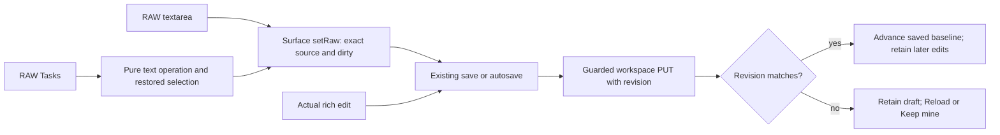

# T22-S2-RAW architecture spec

Verdict: pass
Level: 1 confirmed for the #17/#18 port and its editor CSS; the underlying Series 2 extraction remains level 2 and issue #22's lock/evidence work remains level 1.
Decision: ADR-0002 preserves the existing room-scoped flow; accepted ADR-0008 and the independent T17-18 reclassification resolve the former new-file/module objection. No new architecture decision is required within the binding scope below.
Reviewer: Codex, dispatched Worker Architect, 2026-11-10; report committed with DCO sign-off.

## Reviewed inputs and scope

- Series 2: `cdc3d5c29b7cfd959051b5594f50cef94e3211de`, exact fetched `origin/agents/upstream-series-2` and this report branch's parent.
- Upstream base: `461e6485bf932f5cba85ac3dde8e0104e47d5dec`.
- Fork implementation: `028012127b8686ac0215fe30a4f3d3c3bb2af742`; task diff starts after `9111063fdd58ad96ad27f9bd1967dbe5a8de2a13`.
- Fetched fork main: `fb2ac7aaa5287659ea0da0ec306b60ab60126ac0`; the reviewed implementation is its ancestor. Main is context, not the source of a wholesale port.
- Fork issues [#17](https://github.com/bussard76/exxperts/issues/17), [#18](https://github.com/bussard76/exxperts/issues/18) and [#22](https://github.com/bussard76/exxperts/issues/22), including current comments, read 2026-11-10.
- Series 2 R2 spec review: `5873f4ee17a9678d1835fc336815aeb5f86f8ffd`, `docs/reviews/TSERIES2-R2-architecture-spec.md`.
- Original RAW addendum review: `42bca9d4e9eb09f09a1ae3670c103c7b42742b16`; its level-3 verdict and fold-helper/ADR alternatives are superseded by `71f7e52a5b9759df9ac474a5e344c5d2181c5935:docs/reviews/T17-18-RECLASS-architecture-spec.md` and ADR-0008. Do not revive ADR-0007 or remove the helper to satisfy that obsolete objection.
- Functional R2: `c7c6ac899865458aa3215ef3020b470bdaa8bd30:docs/reviews/T17-18-review-2.md`; subsequent functional pass/debt disposition: `b56f1096fd8bcc3b4082d2809949dacea6e34493:docs/reviews/T17-18-review-final.md`. Both concern exact implementation `0280121`, not a Series 2 port.
- Issue #22 Series 2 R2 review: `d018916a8da752cc040677e77ca97d4f5efedfdd:docs/reviews/T22-SERIES2-R2-architecture-spec.md`. Its lock, Node, licence and final-candidate evidence obligations remain binding and are not certified here.

Controller documents were read only from this project's `/home/developer/controller-exxperts/specs/`:

| Document | SHA-256 |
| --- | --- |
| `series-2-raw-tasks-addendum.md` | `ea0b81e37db130af0ba80f25974a553ab2634fd684ca7a733079db1c8797323d` |
| `series-2-spec-revised.md` | `32a4aaccb6b6b3c1d77582b9147a70a64ff984ee91edfe5b2d709cd92236d784` |
| `series-shared-contract.md` | `94cea4dbe2222954b4167042171918274cb174d6b1806dca77d7e0b1d1de8d3e` |
| `series-controller-decisions.md` | `6906ea2eaf50854a3ff43104389b8af13880b3d7489cffe00d06e00cdbef5484` |
| `t22-node-matrix.md` | `f214b90dc369e74af1e1a1e479b39f7ec1fcfc86ace1a2457b5df516b4bbec93` |

The dispatch explicitly requests this RAW/CSS review in parallel with #22. It does not authorize implementing either task. The addendum's old Front commit names and four-commit inventory describe earlier heads; the dispatch's exact reviewed `0280121` and the five actual commits below fix the port source. This is a precision update, not a different product design.

## Architecture impact

#17 adds RAW input to the existing Markdown editing module's draft/save/conflict machinery. #18 adds pure text operations and a private toolbar prop within that same topic. Pane growth and task alignment are local CSS. No package entry-point export, route, dependency, store, permission or browser/server data flow changes. The helper's file exports are internal to editing; its only production consumer is the pane. No prefactoring is needed.

The existing Series 2 editor pane, toolbar, sync hook, Markdown API consumer, file browser and tabs are byte-identical to the fork task's parent `9111063` at the inspected paths. The full task diff contains six files. A read-only `git apply --check` of its five non-CSS files succeeds on `cdc3d5c`; including CSS fails at source context line 361. This proves textual applicability only, not runtime compatibility. The missing context is unrelated preview CSS; importing that context would broaden the contribution unnecessarily.

## Fit checklist

| Requirement | Owning module and seam | Boundary/data flow | Evidence or binding instruction |
| --- | --- | --- | --- |
| Editable RAW, unchanged caller interface | Markdown editing; `MarkdownEditorPane`, private `SurfaceHandle` | `setRaw(text: string): void` and `leaveRaw(): void` extend only the private surface; external handle remains `save(): Promise<boolean>`, `discard(): void`, `focus(): void` | Preserve existing pane props and App dirty callback. No second persistence implementation. |
| One source and save ownership | Surface source/baseline; pane draft mirror; sync hook external reconciliation | Exact source is retained in `rawRef` until a real rich edit; leaving RAW loads TipTap without itself dirtying or serializing the source | Preserve no-typing round trips, accepted external replacement, Reload/discard, later edits during save and Keep mine. Assertions must compare file bytes, not only rendered text. |
| Tasks and selection | Internal `markdown-raw-tasks.ts` -> pane -> toolbar | `cycleTaskLines(value: string, start: number, end: number): {value: string; selectionStart: number; selectionEnd: number}`; `isTaskLine(value: string, position: number): boolean`; private `raw?: {taskActive: boolean; onTask: () => void}` | Pane owns DOM selection and restores it after render. #18 depends on completed #17. No shared/package export is added. |
| Empty and mixed selections | Same text operation | Each nonempty selected line independently cycles plain/bullet -> unchecked -> checked -> unchecked; preserve indentation and existing bullet | Empty/whitespace-only blocks are no-ops; blank lines stay blank; `x`/`X` count as checked. A selection ending at the next line's start excludes it; a caret changes its own line. Preserve the reviewed behavior without adding another syntax policy. |
| Modes, errors and permissions | Pane phases `loading`, `ready`, `saving`, `conflict`, `error`; existing server authority | RAW textarea is `readOnly={!canEdit}` and task action checks write permission; errors retain draft, Reload adopts server content, Keep mine uses latest revision | Retain one-second autosave, five-second polling, Save/Discard/Cancel navigation and returned-revision save loop. Read-only paired devices cannot acquire writes through RAW. |
| Bounds and privacy | Existing guarded Markdown and image routes | Existing `.md` files only, <=131072 UTF-8 bytes, strict decoding/no NUL, SHA-256 revision, no create; local images <=20 MiB | Keep current grants, fingerprint, denied paths and symlink checks. No OS opener, model call, HTML sink or external image fetch is introduced. Input errors remain server-owned. |
| CSS and geometry | Editor rules in `43-room-workspace.css` | Existing pane/body/surface flex chain; raw toolbar above scrolling textarea; task labels aligned to text | Apply only the editor delta described below; preserve >=500px RAW height at 1280x900 and <=3px checkbox/text center offset. |
| Outside-in evidence | Existing workspace-files surface/interfaces/logic plus RAW addendum | `b702c9d269f4daa69076c089325172daa59be72d:design/workspace-files/README.md` records signed-off screens, T5 interfaces and tree -> editor -> guarded save/conflict diagram | RAW extends the already accepted flow internally. The source series has no feature design export. A separate RAW design export remains documentation debt; no unresolved interaction choice or new flow is established. |
| Parallel owners and composition | Lock worker owns metadata; RAW porter owns six product files; Series 1 owns canonical shared producers; Controller owns staging | Product-only port and lock correction are separate, non-overlapping deltas; final combined candidate gets its own evidence | Do not mutate another worker's branch or assume a moving tip. Controller names the immutable candidate and records dependencies before dispatch; standalone passes do not establish Series 1+2 composition. |

## Fixed interfaces and ownership

The following existing interfaces remain fixed; the RAW port has no reason to edit their implementations:

- GET/PUT `/api/persistent-agents/:id/workspace-markdown` query `{conversationId: string, path: string}`; PUT JSON `{content: string, revision: string}`. Success is `{agentId: string, conversationId: string, path: string, content: string, encoding: "utf-8", bytes: number, revision: string, readOnly: boolean}`; the browser's `WorkspaceMarkdownFile` intentionally omits the two IDs. Errors preserve `{error: string, code?: string}` and conflict `currentRevision?: string`; stale revision is 409 `revision_conflict`. GET is remote `read`, PUT is `write`.
- GET `workspace-files` retains `{agentId, conversationId, root: {displayLabel: string, basename: string} | null, path: string, entries: {name: string, relativePath: string, kind: "file" | "directory", bytes: number | null, modifiedAt: string, extension: string}[]}`. Missing grant/list permission remains null root with empty path/entries. No new listing interpretation is needed by RAW.
- GET `workspace-image` retains raw bytes, existing MIME allowlist and CSP/nosniff/no-referrer/no-store headers. `persistent-room-workspace-image.ts` remains the sole image producer and sole definition of `PersistentRoomWorkspaceMarkdownError`; Markdown imports/re-exports that exact class identity. Do not copy the fork's older combined image/Markdown implementation over this split.
- Tabs remain `{agentId: string, conversationId: string, paths: string[]} | null`, active path held separately. `WorkspaceFileTabs` props remain `{tabs: string[], active: string | null, onSelect(path: string): void, onClose(path: string): void, onReorder(paths: string[]): void}`. Preserve no duplicates, conversation identity, background close, right-neighbor then left close and dirty navigation. File drag MIME remains `application/x-exxperts-workspace-path`; tab reorder uses `application/x-exxperts-workspace-tab`. Neither is changed by this port.

## Binding ordered product-only port

After Controller direction, preserve these five source changes in order after the existing Series 2 editor commits. The final correction is mandatory; stopping at the first four would restore the reviewed round-1 defects.

| Order | Exact source commit | Required content |
| --- | --- | --- |
| 1, #17 | `f999d7a54d1cc6201875884601c6e92a9e3e1e58` | Editable RAW and its browser smoke through the existing save machinery; RAW textarea CSS. |
| 2, #18 | `cc79d8021c54eda5cd059d645e497b7eaaac7615` | Task text helper and helper smoke, textarea selection/action, Edit checkbox click recognition and browser checks. |
| 3, height | `62139751758b5a1890645213a0b195a5fc7f6097` | Pane flex growth and RAW height assertion. |
| 4, alignment | `bc3743c35690b5625437e49910a699b1b1dfa486` | Task-label/input/paragraph alignment and center-offset assertion. |
| 5, R1 corrections | `028012127b8686ac0215fe30a4f3d3c3bb2af742` | Exact-source round trips and later saves, per-line cycles, visible RAW toolbar/task state, disabled unsupported actions, and all revised tests. |

The code/test allowlist is exactly:

1. `apps/web-ui/src/components/MarkdownEditorPane.tsx`
2. `apps/web-ui/src/components/MarkdownEditorToolbar.tsx`
3. `apps/web-ui/src/markdown-raw-tasks.ts`
4. `apps/web-ui/src/styles/43-room-workspace.css` (editor hunks only)
5. `apps/web-server/scripts/markdown-raw-tasks-smoke.ts`
6. `apps/web-server/scripts/workspace-markdown-raw-ui-smoke.ts`

Retain each source commit's attribution and DCO sign-off on new commits. Inspect the entire final delta against the designated Series 2 parent. Do not merge fork main, copy the whole stylesheet, import #12/#16 shell changes, expand manifests/exports/routes, or bring in Series 1 renderers, Excalidraw, OS-open code, design/process specs, ADRs, factory files or this report. Keep all pre-existing Series 2 tests and both added smoke files; no assertion weakening or skip substitution. Any required product documentation should be a narrow update to the existing product documentation, separately identifiable from these six source changes.

### Exact CSS reconciliation

Port the editor hunks against the existing Series 2 stylesheet, maintaining this final result:

- Add `flex: 1 1 auto` to `.markdown-editor-pane` so it fills the available space below tabs.
- Replace the obsolete `.markdown-editor-surface-hidden` rule with `.markdown-editor-surface-raw { flex: 0 0 auto; }`, `.markdown-editor-surface-raw .markdown-editor-rich-scroll { display: none; }`, and `.markdown-editor-body-raw { flex-direction: column; }`. The toolbar remains mounted/visible while its rich scroll area is hidden.
- Add `.markdown-editor-raw-input` with the reviewed declarations: `display: block; flex: 1 1 0; min-height: 0; width: 100%; box-sizing: border-box; border: 0; outline: none; resize: none; tab-size: 4`. Place it beside existing RAW editor rules rather than importing absent preview selectors to satisfy end-of-file context.
- Replace the task label's `margin-top: 5px` with `display: flex; align-items: center; height: 1lh; margin: 0`; set its input margin to zero and the task content's first/last paragraph top/bottom margins to zero. Keep all selectors scoped under `.markdown-editor-tiptap .ProseMirror ul[data-type="taskList"]`.
- Preserve Series 2's remaining typography, colors, 16px RAW padding and scrolling, rich text/table/image/search styling, focus styles, toolbar sizing, desktop drag regions, responsive rules, tabs and existing sidebar geometry. In particular, the fork comparison also contains an unrelated 8px -> 1px sidebar change, header height/padding/title changes, collapsed-right-pane toggle rules and preview/spreadsheet styles. Those are not RAW changes and must not be copied.

The exact existing browser assertions at `0280121:apps/web-server/scripts/workspace-markdown-raw-ui-smoke.ts:87,107-110,173-178` remain binding: viewport 1280x900; textarea height >=500px **and** >= body height minus 60px; every task checkbox vertical center differs from its text paragraph center by <=3px. Do not replace the absolute height check with a proportional check or relax either tolerance. Preserve Edit, Preview, RAW and read-only presentation when resolving context conflicts; browser evidence on the port is still required.

## Acceptance, dependencies and separate composition gate

The RAW porter depends on this addendum pass, the recorded fork functional/reclassification passes and Controller direction. T22-LOCK2 owns the isolated lock correction starting at `cdc3d5c`; it must not port RAW/CSS. The Controller must select and record the resulting immutable product-only Series 2 candidate containing both accepted deltas before final validation. If work is concurrent from `cdc3d5c`, carry only reviewed product commits onto that candidate and rebind checks to the resulting SHA; neither branch may absorb review/factory history or edit the other's files. Any changed interface, dependency, route or data flow returns for classification.

Required evidence on that Series 2 tip:

- Run the preserved helper and RAW browser smokes plus the existing Series 2 route/image/editor/tab/drag/navigation acceptance. The RAW smoke launches the actual local server with invented files and exercises textarea/toolbar -> pane -> real GET/PUT -> on-disk bytes. The helper test alone is insufficient. A skipped Chromium path is incomplete even if the runner exits zero.
- Preserve exact-source, no-change round trips, actual Keep mine and Reload, failed save retention, edits during a held PUT, clean external replacement, discard and subsequent save behavior through the real producer and consumer. Preserve read-only and paired-device policy, mixed/nested selected tasks, repeated cycles, caret active state and both Edit checkbox directions followed by RAW. Geometry checks execute on the port's built UI. Existing functional evidence at `0280121` is historical evidence, not a new pass on the extracted tip.
- RAW disables Undo, Redo, paragraph, H1-H3, blockquote, bold, italic, strike, inline code, link, bullet/numbered lists, Find, Insert table and Copy; Tasks uses visible RAW text. Save keeps its existing dirty/saving/conflict restrictions. The known Delete table visibility omission remains accepted style debt and preview acceptance, not a port blocker or an instruction to redesign the toolbar.
- Preserve #22's no-worse-than-upstream lock bar, exact dependency graph/licence proof and Node matrix on the final candidate: runtime build first on Node 20.6.0 and 22.23.4, applicable common/series checks and target-Node child proof. Add the ported RAW/tasks checks to the final series acceptance; do not treat baseline-only absence, matching build failures, Variant C's different graph or browser skips as success. This review does not approve an engines or lock-generation change.
- The independent Tester owns the standalone full build/smoke gate and task review; level-2 Series 2 conformance remains required. Serialize host-wide full gates and retain task/worker/role/agent/model attribution. No gate was run by this Architect.

After both series independently pass, the Controller still owns a **separate staging branch**, applying Series 1 first and reconciling Series 2 afterward, without cross-merging the contribution branches. Reconcile overlapping `App.tsx`, listing/tree/tabs/drag, CSS, room routes, guard/image implementation, remote policy and locks once. Composed `.md` selection opens the Series 2 editor (128 KiB strict UTF-8); it must not inherit Series 1's inert 16 MiB replacement-decoded Markdown preview behavior. Other supported files retain Series 1 previews. No #17/#18 behavior is ported into standalone Series 1.

The composed-tip independent gate must use the real Series 1 listing/image producer and actual Series 2 editor consumer: open Markdown, load local images, send zero external/protocol-relative image requests, edit RAW and use Tasks, save and reload bytes, conflict/Keep mine, failed-save retention, dirty Save/Discard/Cancel across file/preview/room/conversation changes, and tabs/drag. Exercise every Series 1 preview and both acceptance sets, including the two geometry checks after CSS reconciliation. Keep a single image producer/error-class identity and current authorization. Two standalone green gates, helper tests or a mocked successful producer do not prove composition. Sascha's preview/native-platform acceptance and existing debt remain separate.

## Findings and limits

1. **Pass, level 1:** no unresolved design choice or new architectural seam is required by the bounded port. The exact five-commit source, CSS allowlist, ownership and final-candidate requirements above are binding precision instructions. Any incompatible change discovered during implementation must return with its concrete interface/diff; this pass is not blanket permission to reconcile arbitrary fork changes.
2. **Carry existing debt:** missing committed browser coverage for some independently exercised source-preservation and nested-task paths, fresh-page uncheck coverage, Delete table visibility and fd/case-insensitive/native-platform gaps remain debt under the recorded functional disposition. They do not establish a new functional defect here or justify changing the accepted architecture. Required port/composition evidence must still be collected; historical source reports do not certify it.
3. **No completion claim for the contribution:** no install, build, typecheck, smoke suite, browser, gate, registry call, real model or real-data access was performed. Verification was issue/spec/decision/code reading, exact blob/diff/ancestry comparison, and non-mutating patch applicability checks. No implementation, original series branch or fork main was changed. Only this report is committed and pushed on `agents/t22-s2-raw-specreview`; it is not part of the product contribution.
4. **Preserved unrelated work:** after an initially clean status, `package-lock.json` became modified and blocked branch creation. The coordinator explicitly authorized preserving it in a uniquely named stash. Object `6b76611f54e5a7b00d26efe3a8bce910a5d2c003` (created as `stash@{0}`, message `T22-S2-RAW preserve unowned lock metadata before architecture review`) has base `fb2ac7aaa5287659ea0da0ec306b60ab60126ac0`; it was not popped, discarded or included in this report. All source conclusions use committed objects.
