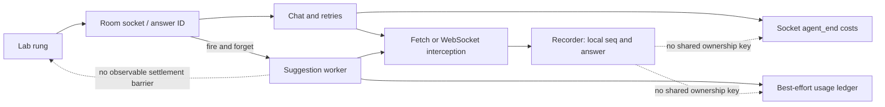

# T24 Thinking Sweep lab amendment

Decided by: Sascha (2026-11-27), via Front. “Ja, nimm jeweils die Empfehlung” selects Option A for the Thinking Sweep lab.

**Architecture impact: level 2 within T24's accepted level-3 scope.** Limit the change to the existing Thinking Sweep lab, its preload recorder, its private record reader and targeted tests. Slice 1's producer, wallet and room socket contracts remain the source of truth. No production header, public API, new storage or logging of request or suggestion content.

The recorder must continue to record every provider call it allows to leave, including suggestions, and fail closed if logging cannot occur. Identify a rung call using reliable existing in-process evidence. Retain only technical metadata needed for classification, correlation and cost accounting. An old, missing or ambiguous category cannot establish a rung verdict. Keep unrelated calls outside the rung verdict and avoid charging unrelated traffic to the isolated run. Count all attributable spend in the lab budget, including suggestions and retry attempts that incurred cost. Correlate cost and classify it once. Before sending a subsequent rung, handle incomplete attribution or spend through an explicit lab diagnostic without treating an unknown cost as zero. Keep the selected-rung response, TSV concepts and budget threshold semantics unless the independent review finds a genuine contract gap.

Use the real lab and recorder with fake providers. Keep the recorder-versus-provider equality check, refusal on unavailable logging, existing chat/tool/retry rung evidence and privacy checks. Add a same-model suggestion scenario that remains in the recorder and contributes a known nonzero amount to the budget without influencing the rung judgment, and exercise unavailable classification or accounting. Show failing evidence before the fix and passing evidence on the same targeted path afterwards. Document any strictly necessary assertion adjustment and how the original coverage remains. Independent Architect review must verify the category source, data shape, correlation and complete cost evidence before implementation. No Slice 2 or Slice 3 changes.

## Rework 2: evidence and decision required

**Implementation blocked; Option A is not yet an implementable lab-only contract.** The selection above did not approve a new production correlation flow. The following assessment is against product commit `fc1049aa828ebddfb1d6a89fa58fabf8611a685f` and independent review `db167f3e9c432743f61a53813e77e8ba7f7d48d1`. No implementation is authorized by this section.

### What was checked

- `apps/web-server/scripts/thinking-levels-sweep-recorder.mjs:66-71,172-193,195-235`: the preload intercepts watched fetch bodies and WebSocket sends and assigns a local `seq`. The request contains `at`, `path`, `transport`, `model` and thinking fields, but no room, run, rung, answer or call category; `seq` joins only its own request and answer. Neither transport seam receives the room socket's identity. Unrelated same-model traffic and an older suggestion can therefore look like the next rung. This assessment does not claim that an arbitrary stack, prompt text, model, ordering or timestamp supplies an identity.
- `apps/web-server/src/room-socket.ts:1659-1668,1669-1750,2387-2390,2813-2817`: answer identity exists in the room closure, and a successful `agent_end` starts an isolated suggestion worker without awaiting it. Its promise records usage later; cancellation aborts and deletes the map entry immediately, not on worker settlement. Lifecycle completion and the `suggestions` frame do not prove that every worker, cancelled worker, retry, recorder answer and usage write has settled. A quiet period, socket effort echo or worker timeout is not a proof that no late work or usage can arrive, including after the final rung.
- `apps/web-server/scripts/thinking-levels-sweep.ts:253-257,292-345,394-445`: the sweep sums `agent_end` costs, then selects recorder calls by model and lower timestamp with no upper bound. Its recorder wait returns on timeout and cannot prove no further request will start. The socket and suggestion ledger are not disjoint by a shared identity; summing both without a proven partition risks double counting.
- `apps/web-server/src/usage-log.ts:16-40,45-48,65-71` and `usage-recording.ts:33-63`: usage has room, kind, model and time but no recorder sequence or answer/rung key. A worker may have no usage row; missing values become zero and append failure is only warned. A worker aggregate need not identify individual retries. `usage-api.ts:93-108,130-143` distinguishes turn cost, today's estimate and unpriced usage, and billed, plan and unattributed sources; neither that distinction nor the recorder's zero-defaulted counters establishes a complete price for every attempt. A failed or cancelled request may have incurred unknown cost.
- `thinking-levels-sweep-recorder.mjs:74-80,118-123,138-163,185-188` records arbitrary provider/error text, including HTTP bodies and thrown messages. Those can echo synthetic or real content. The request-only privacy assertion in `thinking-levels-sweep-smoke.ts:267-274` does not cover answer errors.

The existing sources do not demonstrate a reliable lab-only classification and correlation, complete priced accounting with provenance, or a bounded completion barrier. In particular, request/answer `seq` is not a run or answer identity, `answer_lifecycle: complete` is not suggestion settlement, and the absence of a ledger row is not evidence of zero spend. The current `SweepResult.costUsd`, numeric per-row cost and TSV cost column cannot represent that uncertainty as complete totals without a separately reviewed contract. Do not send another rung or return a successful final verdict on ambiguous ownership, missing records, missing usage, unpriced or unattributed spend, or an unproven closure; known spend retains the `costUsd >= maxUsd` stop threshold. This is a required behavior for a future approved design, not a claim that the current lab already enforces it.

### Smallest decision to unblock

Ask Sascha, through the Controller, which scope to authorize; the Architect must classify and review the chosen design before implementation:

1. **Recommended: authorize a separately specified production instrumentation design.** Expose a content-free, scoped run/rung/answer identity and call category at both provider interception paths, plus a terminal lifecycle signal covering retries and suggestion workers, including cancellation and final-rung settlement. Specify a provably disjoint per-attempt or aggregate cost source, usage completeness, price and billing provenance, failure semantics and a bounded fail-closed barrier. This changes a production boundary/data flow and requires level assessment and any required ADR; it is not approved by Option A or ADR-0009. Even with identity, absent provider usage or price remains an explicit incomplete cost, not zero.
2. **Choose a narrower, separately approved lab behavior:** run only under a mode that prevents suggestion generation and unrelated traffic, if a design can prove that mode and its accounting/closure guarantees. Disabling suggestions changes behavior and cannot silently satisfy the selected suggestion-inclusive scope. Paid failures or missing pricing still require incomplete diagnostics and stopping.
3. **Defer the sweep amendment.** Leave the existing lab's results explicitly unsuitable for suggestion-inclusive attribution and complete-budget claims until a viable design is approved. This introduces no new production behavior or data path.

For any subsequently approved design, require an explicit typed private request/answer and lifecycle contract, unknown/legacy/inconsistent handling, disjoint accounting and provenance, bounded closure before each next send and final return, and incomplete representation in `SweepResult`, rows and TSV without treating unknown as zero. Technical error reporting must use only an allowlisted status and fixed local error category; never persist provider body, message, headers, prompt, suggestion or arbitrary thrown text in the recorder or output artifacts. Preserve refusal before departure on request-log failure and the recorder-versus-provider equality assertion for all provider calls. Its fake-provider acceptance cases must cover fetch and WebSocket echoed synthetic secrets, earlier and final-rung late suggestions, unrelated same-model calls, ambiguous evidence, retries, missing usage, unpriced costs, overlapping sources and recorder/ledger failures, while retaining chat/tool/retry and 15-rung TSV/verdict coverage. These are review requirements, not a claim that an evidence source or interface has been chosen.
