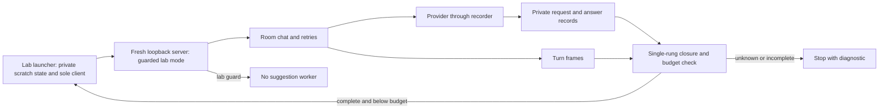

# T24 Thinking Sweep lab amendment

**Decision:** Sascha, 2026-11-27, via Front: “B, Vorschläge im Labor abschalten” (`msg_02ae4334eba6`). This supersedes the earlier suggestion-inclusive Option A and the recommendation for production correlation instrumentation in rework 2. Suggestions are suppressed only in the isolated Thinking Sweep server; ordinary rooms retain their existing behavior. This is a spec for independent Architect review, not authorization to implement before that review.

## Architecture impact

Proposed level 2, subject to fresh Architect classification: the existing lab launcher, sweep, recorder and private record reader gain a guarded lab mode; the existing suggestion producer gains a private process-local guard. No public setting, production instrumentation, provider header, public API, new network/data path or suggestion content logging. If the isolation or accounting contract cannot be met within that boundary, stop and return the gap for a new scope decision. ADR-0009 does not approve a new production correlation flow.

## Evidence and boundary

At `fc1049aa828ebddfb1d6a89fa58fabf8611a685f`, `apps/web-server/scripts/thinking-levels-sweep.ts` exports `runSweep` and its CLI accepts `--run`, pointing at an independently started server; `thinking-levels-sweep-smoke.ts:168-225` starts a real server in a scratch home with the existing recorder preload and a synthetic provider. An arbitrary existing `--run` server is not proof of isolation. The profile's `processes.absorb` is also used for memory (`persistent-agent-ai-profiles.ts:127-136,160-162`); a missing or invalid maintenance model is not an explicit, reliable suggestions-only switch across providers. Do not repurpose it or infer suppression from model selection.

`room-socket.ts:1664-1750,2387-2390` starts suggestions asynchronously after a successful answer, and cancellation removes tracking before settlement. `thinking-levels-sweep-recorder.mjs:66-71,172-235` supplies a local request/answer `seq`, not room or rung identity, and the current sweep selects by model and time (`thinking-levels-sweep.ts:338-345`). `usage-log.ts:16-40,65-71` and `usage-recording.ts:33-63` do not supply a per-attempt join and can omit or default usage; `usage-api.ts:93-108,130-143` distinguishes unpriced and unattributed usage. Thus the pre-decision evidence cannot prove the previous suggestion-inclusive accounting or barrier. Suppression and exclusive ownership remove that particular ambiguity, but do not make missing usage, a failed attempt, or a timeout free.

## Proposed activation and isolation contract

The lab entry point remains `apps/web-server/scripts/thinking-levels-sweep.ts` and its exported `runSweep`. Replace arbitrary attachment for a sweep with a lab-owned launcher that starts and owns a **fresh** server process and its entire lifetime, with a fresh private scratch home, private room store, recorder log, random authentication token, loopback-only listener and no pre-existing rooms, schedules, background jobs or credentials. Only that sweep client holds the token; no other clients or traffic are allowed. Refuse an existing/shared server, reused state, non-loopback binding, a concurrent sweep, or an unexpected authenticated client. The launcher uses the existing server and provider transport; it must not add a proxy, endpoint or other network path. If the server cannot enforce exclusive ownership under those constraints, refuse before the first provider request and return the design for review; isolation is not established by a timestamp or a convention that other users stay away.

The following is the proposed **private** activation interface, not an existing setting: the launcher passes `THINKING_SWEEP_LAB=1` only to its child server, together with the existing `NODE_OPTIONS` recorder preload, `THINKING_SWEEP_LOG` and explicit `THINKING_SWEEP_HOSTS`. At server startup, accept the switch only when the lab launcher owns the fresh child process and has established scratch ownership, loopback/exclusive-client restrictions and an active writable recorder; an env variable alone must not activate it. The launcher passes a random one-run capability in the child environment and supplies its expected digest to the existing private recorder log reader. The shared process-local guard used by the producer appends exactly `{ kind: "lab_ready", version: 1, capabilityDigest: string, suggestions: "disabled", recorder: "ready", exclusive: true }` to that existing log only after validation. The parent checks the digest and child liveness before `runSweep` sends a prompt; absent, malformed, stale or mismatched readiness, failed isolation, unavailable recorder, or a non-lab server means refusal before provider departure. Never log the capability itself. This uses the existing private recorder path; if ownership or exclusivity cannot be proven through it without another data path, stop for a scope decision.

In `room-socket.ts`, the sole guarded branch at the `generateSuggestions` call site skips starting that worker when this validated process-local lab mode is active. With no validated lab mode the existing call path is unchanged, including its lifecycle, cancellation and usage behavior. No UI control or ordinary configuration exposes the switch; an accidental environment variable without the launcher and readiness validation must fail closed rather than suppress production suggestions. The launcher terminates its child and discards scratch state on completion or failure. The smoke uses only invented data and synthetic providers; development must not make real provider calls.

## Closure, cost and output

The isolated lab runs one rung at a time. Before each send establish an empty, consistent recorder boundary; after turn settlement, collect all request and answer pairs since that boundary and the entire ordered socket turn, including retries and tool calls. A bounded wait is only a deadline: it never proves completion by itself. The next rung and final return require proof that the turn is settled, no provider attempt or recorder response remains in flight, every departing request has exactly one terminal record and a corresponding disjoint cost contribution, and no unexpected request/client appeared. Missing, duplicate, late, inconsistent or unjoinable evidence is `incomplete`, not a verdict. If the existing transport and frames cannot prove this for a case, stop; do not use model/time as an ownership join or assume a failed/cancelled request costs zero.

For the private reader use `RecordedCall = { seq: string; transport: "fetch" | "websocket"; model: string; sent: SentThinking; answer?: { status: number; usage: { input: number; output: number; cacheRead: number; cacheWrite: number; cacheWrite1h?: number } | null; error: "http_error" | "provider_error" | "transport_error" | "unreadable" | null } }`, where `null` usage means absent, not zero. Request and answer share `seq`; reject legacy, malformed, duplicate and unmatched lines. Include only typed thinking fields and numeric counters already needed to judge the rung; never retain arbitrary request/response text, headers, error messages or provider bodies. Keep HTTP status and the fixed error category for technical refusal diagnostics, for both transports. Request logging must still refuse departure if unwritable; answer-log failure makes the run incomplete.

Every attempt must have either a provably disjoint, complete cost contribution from its own socket usage or complete provider usage plus an explicitly identified applicable price. Record price provenance as `"turn" | "estimated" | "unpriced"` and billing source as `"billed" | "plan" | "unattributed"`; never add the same attempt's socket and calculated cost. A verified zero with complete usage and a known price is zero; absent usage, unpriced, unattributed, failed attempts with unknown cost, missing cache inputs or non-finite values are incomplete. A provider's silence is not evidence of a free retry. Preserve the known-spend stop threshold `costUsd >= maxUsd`.

Proposed lab result interface: `SweepResult` retains `rows`, `stoppedForBudget` and `notSwept`, changes `costUsd` to `number | null`, and adds `completion: "complete" | "incomplete"` and `diagnostic?: "isolation" | "recorder" | "ownership" | "closure" | "usage" | "price" | "source"`. `SweepRow.costUsd` likewise becomes `number | null`; `null` means the complete amount is unknown, including when some spend is known. The existing TSV column order stays unchanged; a null cost is an empty `cost_usd` cell and the verdict says `incomplete: <diagnostic>`, never `ok` or `0`. Remaining rungs say `not run (incomplete)`; no further provider send occurs. Only complete, known sums populate total/row costs; no estimated total is described as exact. This private interface and any consumer adjustments need Architect review. Keep selected-rung semantics and all existing rung, retry, tool and budget assertions intact.

## Acceptance for the subsequent implementation

- Exercise the real launcher, `runSweep`, server, recorder and synthetic provider with a valid profile that would normally generate suggestions. Prove all successful lab answers generate no suggestion request or frame and no suggestion usage, including the last rung; all received provider calls equal all recorder request records, without filtering either list or changing existing assertions. Retain the existing 15-rung TSV/verdict, chat/tool/retry, unavailable-log refusal and budget checks. Do not modify fixtures to hide suggestions or weaken existing assertions.
- Separately run the existing `suggestions-producer-smoke.ts` against its normal fake producer setup with no lab activation; it must continue to prove ordinary suggestion generation and lifecycle. A direct env-only launch, missing/mismatched readiness, wrong server, non-loopback, reused scratch state, concurrent or unexpected client, and recorder failure must refuse before provider receipt. Prove the validated guard is the one used at the real producer call site.
- With synthetic providers cover fetch and WebSocket errors echoing a synthetic secret/prompt; neither recorder, TSV, diagnostics nor console output may contain it. Cover priced and explicitly free usage, paid retry, missing usage, unpriced and unattributed cost, incomplete answer, unknown failed-attempt cost, duplicate/missing record, log failure, timeout, overlap/double-count, late call and final-rung closure. Assert no next send and an explicit incomplete result where evidence is insufficient. If existing public evidence cannot make a paid retry both complete and provably disjoint, report the gap rather than fake cost evidence or weaken assertions.
- Tests are test-first through the actual entry points, with the same original assertions and fake-provider receipts; no fixture filtering or assertion rewriting. A fresh independent Architect reviews this spec before any implementation. No product code, tests or gates are part of this spec revision.
